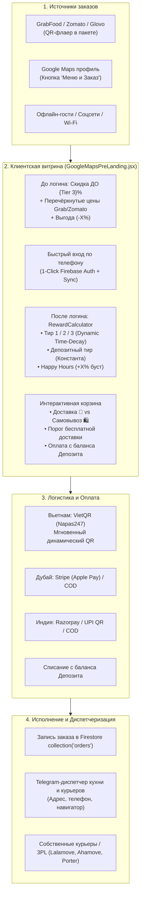
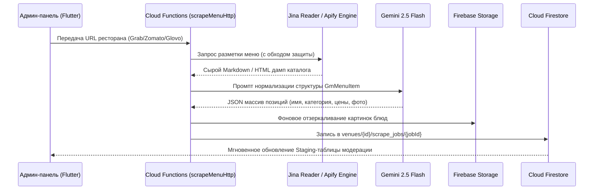

# Revoo Direct Delivery: Архитектура модуля онлайн-доставки и перелива из агрегаторов

**Версия:** 1.0 (Production Ready)  
**Статус:** Реализовано и верифицировано E2E тестами (Playwright)  
**Назначение:** Полный комплекс онлайн-доставки, перелива аудитории из агрегаторов (GrabFood, Zomato, Glovo, Talabat, Swiggy) и Google Maps в собственную DTC-витрину заведения без комиссии платформ.

---

## 1. Бизнес-цели и концепция (Executive Summary)

Комиссия агрегаторов доставки (Grab, Glovo, Zomato, Talabat) составляет **от 25% до 35%** с каждого чека.  
Модуль **Revoo Direct Delivery** решает ключевую задачу ресторана:
1. **Перелив существующей базы клиентов агрегатора в прямой канал Revoo:**
   - Вкладыш с QR-кодом в пакете доставки из Grab/Zomato/Glovo или кнопка «Меню и Заказ» в профиле Google Maps ведет прямо на витрину заведения.
2. **Экономическая мотивация для гостя:**
   - На витрине гость наглядно видит зачёркнутую цену агрегатора (например, *«В Grab: 155 000 ₫»*) и цену прямого заказа Revoo (например, *«120 000 ₫»*).
   - При авторизации применяется персональная динамическая скидка до **20–25%** или баланс депозита. Ресторан экономит на комиссии платформы, а гость получает любимые блюда дешевле, чем в агрегаторе.
3. **Сохранение фирменной механики удержания Revoo:**
   - В онлайн-доставку **полностью перенесена матрица динамических скидок** Revoo: **3 регулярных тира** (в зависимости от интервала дней с последнего заказа) + **1 максимальный константный депозитный тир** + **Happy Hours**.

---

## 2. Общая схема сквозного процесса (End-to-End Workflow)



---

## 3. Архитектура и структура компонентов

### 3.1. Структура файлов в репозитории

```text
FriendlyCode/
├── functions/
│   ├── .env                                # Конфигурация APIFY_API_TOKEN, GEMINI_API_KEY
│   ├── menuScraper.js                      # Модуль скрейпинга (Grab, Zomato, Glovo) + Gemini AI
│   └── index.js                            # Cloud Functions (scrapeMenuHttp, publishMenuHttp, onMenuScrapeJobCreated)
│
├── admin/lib/
│   ├── core/models/
│   │   └── venue_model.dart                # Модели GmMenuItem, DeliveryLoyaltyConfig, HappyHourRule, Payment & Logistics
│   └── features/
│       ├── admin/presentation/screens/
│       │   └── super_admin_venue_detail_screen.dart # Панель Суперадмина (вкладки меню, скидок и оплат)
│       └── owner/presentation/screens/
│           ├── owner_dashboard_screen.dart          # Меню владельца (секция доставки)
│           ├── delivery_menu_manager_screen.dart    # Модерация позиций, массовые скидки, публикация
│           ├── delivery_loyalty_screen.dart         # Матрица скидок, Happy Hours, пороги доставки
│           └── delivery_logistics_payment_screen.dart # Банковские реквизиты, VietQR, Telegram-чат, 3PL
│
├── src/
│   ├── GoogleMapsPreLanding.jsx            # Витрина доставки, сравнение цен, чекаут, VietQR
│   └── logic/
│       └── RewardCalculator.js             # Ядро динамического расчёта скидок (Time-Decay)
│
├── firestore.rules                         # Правила безопасности для orders и scrape_jobs
└── tests/
    ├── test_delivery.cjs                   # 8-этапный Playwright E2E тест мобильной витрины
    └── test_scraper.cjs                    # Юнит-тесты распознавания платформ и нормализации цен
```

---

## 4. Описание подсистем модуля

### 4.1. Скрейпер меню и ИИ-нормализация (`functions/menuScraper.js`)



- **Определение платформы:** автоматический роутинг `food.grab.com` $\to$ Grab, `zomato.com` $\to$ Zomato, `glovoapp.com` $\to$ Glovo, остальные $\to$ универсальный скрейпер.
- **ИИ-структурирование:** Gemini 2.5 Flash извлекает цену агрегатора (`aggregatorPrice`), базовую цену (`price`), категорию и описания блюд.
- **Надёжность изображений:** изображения скачиваются и сохраняются на Firebase Storage заведения, гарантируя стабильное отображение без блокировок по Referer.

---

### 4.2. Админ-панели управления (JTBD Суперадмина и Владельца)

#### JTBD 1: Быстрый перенос меню из агрегатора
- Вставка ссылки $\to$ 1 клик $\to$ статус задачи в реальном времени.
- Автоматическое наполнение Staging-зоны (`_stagedItems`).

#### JTBD 2: Staging-зона модерации и массовая ценовая политика
- Чекбоксы: выбор всех позиций, выбор категории или точечный выбор блюд для добавления в меню доставки.
- **Массовый калькулятор дисконта:** кнопки мгновенного пересчёта базовой цены относительно цены агрегатора:
  $$\text{Price}_{\text{Revoo}} = \text{Price}_{\text{Aggregator}} \times (1 - \text{Discount})$$
  (например: скидка `-10%`, `-15%`, `-20%`).
- **Инлайн-редактор:** ручная корректировка цены, названия, описания или пометка «В стоп-листе».
- **Публикация в 1 клик:** мгновенный перенос в рабочее меню `venues/{venueId}.gmConfig.menuItems`.

#### JTBD 3: Управление скидочной политикой доставки (Онлайн-матрица)
- Переключатель: **«Повторять офлайн-матрицу заведения»** (по умолчанию) или **«Индивидуальные настройки для онлайн-доставки»**.
- **3 регулярных тира:** `percBase` (базовая скидка), `percMedium` (скидка 2 тира), `percVip` (максимальная регулярная скидка).
- **1 депозитный тир:** `percDeposit` (константная скидка при наличии ненулевого баланса депозита).
- **Конструктор Happy Hours:** расписание повышенных скидок (дни недели, интервал часов, дополнительный бонус `+X%` или бесплатная доставка).

#### JTBD 4: Платежи и логистика заведения
- Привязка банковских реквизитов (для генерации QR Napas247 во Вьетнаме).
- Подключение Stripe / Razorpay.
- Настройка тарифов доставки по радиусу и Telegram Chat ID диспетчера для уведомлений.

---

### 4.3. Витрина гостя и логика динамических скидок (`src/GoogleMapsPreLanding.jsx`)

#### Поведение До авторизации (Pre-Login):
- Отображение бейджа **«Прямой заказ • Скидка ДО {Tier 3}%»**.
- В карточках блюд:
  - Цена агрегатора: `<span class="line-through">В Grab: 155 000 ₫</span>`
  - Прямая цена Revoo: `<span class="text-emerald-400 font-black">120 000 ₫</span>`
  - Бейдж экономии: `<span class="bg-emerald-500">Экономия -23%</span>`
- Призыв авторизоваться для активации персональной скидки.

#### Поведение После авторизации (Post-Login):
- Гость входит по номеру телефона (мгновенный беспарольный Firebase Auth).
- Вызывается `RewardCalculator.calculate(...)`:
  - Если `hasLockedDiscount && deposit_balance > 0` $\implies$ присваивается депозитный тир (`percDeposit`).
  - Иначе $\implies$ вычисляется разница календарных дней с последнего заказа/визита и назначается персональный тир (VIP / Medium / Base).
- Оценивается текущее время в часовом поясе заведения: если активны **Happy Hours**, добавляется `happyHourBonus`.
- На чекауте гость видит свой баланс депозита и переключатель для его списания в счет оплаты.

#### Чекаут и VietQR:
- Поддержка двух режимов: **🚗 Доставка курьером** и **🛍️ Самовывоз** (со скидкой за самовывоз).
- Прогресс-бар до бесплатной доставки.
- При выборе **VietQR** система генерирует стандартизированный QR-код банковской системы Вьетнама:
  ```text
  https://img.vietqr.io/image/{bankBin}-{accountNumber}-compact2.png?amount={totalPayable}&addInfo={orderId}&accountName={accountName}
  ```
- Данные заказа сохраняются в коллекцию Firestore `orders`.

---

## 5. Региональная специфика (Вьетнам, Дубай, Индия)

| Параметр | 🇻🇳 Вьетнам (`VN`) | 🇦🇪 Дубай (`AE`) | 🇮🇳 Индия (`IN`) |
| :--- | :--- | :--- | :--- |
| **Валюта** | `VND` (₫, целые числа) | `AED` (د.إ, 2 знака) | `INR` (₹, целые числа) |
| **Доноры меню** | **GrabFood**, ShopeeFood | **Zomato UAE**, Talabat, Deliveroo | **Zomato IN**, Swiggy |
| **Платежи заведению** | **VietQR (Napas247)**, PayOS, COD, Депозит | **Stripe (Apple/Google Pay)**, Ziina, COD, Депозит | **Razorpay (UPI)**, Dynamic UPI QR, COD, Депозит |
| **Курьерские службы** | **Lalamove VN**, **Ahamove**, Свои курьеры | **Lalamove AE**, **Careem Box**, Свои курьеры | **Porter IN**, **Borzo (WeFast)**, Свои курьеры |

---

## 6. Модели данных Firestore

### `venues/{venueId}`
```typescript
interface VenueData {
  name: string;
  currency: 'VND' | 'AED' | 'INR' | string;
  timezone: string; // e.g. 'Asia/Ho_Chi_Minh', 'Asia/Dubai'
  
  // Каталог блюд
  gmConfig: {
    businessType: 'horeca';
    menuItems: GmMenuItem[];
    menuPdfUrl?: string;
    usePdfMenu?: boolean;
    usePhotoMenu?: boolean;
  };

  // Матрица скидок онлайн-доставки
  deliveryLoyaltyConfig?: {
    useCustomDeliveryTiers: boolean;
    percBase: number;       // Тир 1
    percMedium: number;     // Тир 2
    percVip: number;        // Тир 3 (макс. регулярная)
    percDeposit: number;    // Депозитный константный тир
    vipWindowDays: number;
    mediumDays: number;
    freeDeliveryThreshold: number;
    pickupBonusDiscount: number;
    happyHours: HappyHourRule[];
  };

  // Платежные реквизиты заведения
  paymentConfig?: {
    enableVietQr: boolean;
    bankBin?: string;
    accountNumber?: string;
    accountName?: string;
    enableCashOnDelivery: boolean;
    enableStripe?: boolean;
    enableUpi?: boolean;
  };

  // Настройки логистики
  logisticsConfig?: {
    deliveryMode: 'IN_HOUSE' | 'EXTERNAL_3PL' | 'HYBRID_SMART';
    baseDeliveryFee: number;
    maxDeliveryRadiusKm: number;
    telegramChatId?: string;
    selected3PlProvider?: string;
  };
}

interface GmMenuItem {
  id: string;
  name: string;
  category: string;
  description: string;
  price: string;            // Базовая цена Revoo
  aggregatorPrice: string;  // Цена в Grab/Zomato/Glovo
  currency: string;
  imageUrl?: string;
  isPublished: boolean;
  isAvailable: boolean;
}

interface HappyHourRule {
  id: string;
  name: string;
  daysOfWeek: number[];     // 1=Пн ... 7=Вс
  startHour: string;        // "14:00"
  endHour: string;          // "17:00"
  discountBonus: number;    // +X% к скидке гостя
  isActive: boolean;
}
```

### `orders/{orderId}`
```typescript
interface OrderDoc {
  orderId: string;          // e.g. "REV-535871"
  venueId: string;
  venueName: string;
  customer: {
    uid: string;
    name: string;
    phone: string;
    address: string;
    comment?: string;
  };
  deliveryType: 'delivery' | 'pickup';
  items: Array<{
    id: string;
    name: string;
    price: number;
    aggregatorPrice: number;
    count: number;
  }>;
  subtotal: number;
  discountPercentage: number;
  discountAmount: number;
  deliveryFee: number;
  depositDeducted: number;
  totalPayable: number;
  currency: string;
  paymentMethod: 'vietqr' | 'cash' | 'stripe' | 'upi';
  status: 'new' | 'confirmed' | 'cooking' | 'delivering' | 'completed' | 'cancelled';
  createdAt: FieldValue;
}
```

---

## 7. Тестирование и верификация (Quality Assurance)

### 7.1. Модульное тестирование скрейпера
Запуск:
```bash
node tests/test_scraper.cjs
```
Проверяет:
- Корректность распознавания доменов агрегаторов (`detectPlatform`).
- Парсинг и очистку цен различных национальных форматов (`VND`, `AED`, `INR`).

### 7.2. Сквозное Playwright E2E тестирование
Запуск:
```bash
node tests/test_delivery.cjs
```
Автоматический сценарий эмулирует мобильного пользователя:
1. Загрузка витрины ресторана по UTM-ссылке Google Maps (`?utm_source=google_maps&id=...`).
2. Проверка отображения Pre-login бейджа («Скидка ДО ...%»).
3. Проверка карточек блюд со сравнением цен агрегаторов («В Grab: ...», «Экономия -...%»).
4. Добавление блюд в корзину с проверкой инкремента счетчика и плавающей нижней панели.
5. Открытие шторки чекаута, переключение режимов «Доставка» / «Самовывоз».
6. Заполнение контактных данных и выбор способа оплаты (VietQR).
7. Размещение заказа и валидация финального модального окна с подтверждением и QR-кодом оплаты Napas247.

---

## 8. Безопасность и правила доступа (`firestore.rules`)
```javascript
// Заказы доставки (Revoo Direct Delivery)
match /orders/{orderId} {
  allow create: if true;                          // Клиенты могут создавать заказы
  allow read, update: if isAuthenticated();       // Заведение и клиенты читают свои заказы
  allow delete: if isSuperAdmin() || isOwner();   // Удаление доступно только владельцам/суперадминам
}

// Задачи парсинга меню
match /venues/{venueId}/scrape_jobs/{jobId} {
  allow read, write: if isAuthenticated();
}
```

---

## 9. Эксплуатация и мониторинг

1. **Мониторинг фоновых задач парсинга:**
   - Логи Cloud Functions доступны в Google Cloud Console / Firebase CLI:
     ```bash
     firebase functions:log --only scrapeMenuHttp,onMenuScrapeJobCreated
     ```
2. **Проверка сборки фронтенда и админки:**
   - React клиент: `npm run build`
   - Flutter админка: `cd admin && flutter analyze`
3. **Обновление токена Apify при необходимости:**
   - Переменная `APIFY_API_TOKEN` находится в файле `functions/.env`.
