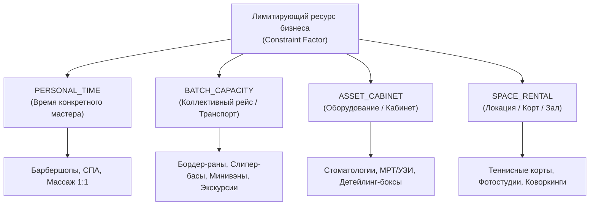
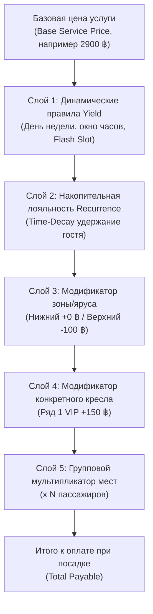
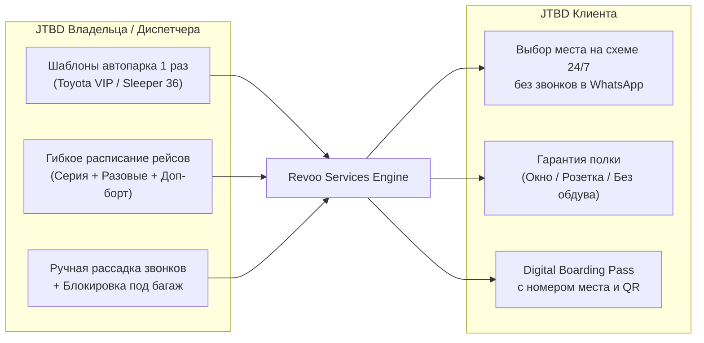

# Revoo Services: Dynamic Capacity, Universal Decks & Multi-Zone Seating, and Yield Management (Source of Truth)

**Документ:** Архитектурный стандарт и Source of Truth (SoT)  
**Директория:** `Bible_SoT/Dynamic_Capacity_Yield_and_Seating_SoT.md`  
**Версия:** 1.0 (Production Implemented)  
**Статус:** Реализовано и протестировано (Playwright E2E 10/10)  
**Область применения:** Экосистема `Revoo Services` (`businessType: 'services'`), модуль бронирования и диспетчеризации ресурсов (`PERSONAL_TIME`, `BATCH_CAPACITY`, `ASSET_CABINET`, `SPACE_RENTAL`).

---

## 1. Введение и бизнес-контекст (Executive Summary)

В сервисных бизнесах (non-HoReCa) ключевым фактором себестоимости и маржинальности является **утилизация лимитирующего ресурса (Constraint Factor)**.

Традиционные системы бронирования (YClients, Fresha, Altegio, 12Go, Traveloka) страдают двумя фундаментальными ограничениями:
1. **Пассивность ценообразования:** Слоты продаются по плоской фиксированной цене независимо от времени суток, дня недели или оставшихся часов до выезда, что приводит к простою мощностей во вторник днем или полупустым рейсам среди недели.
2. **Жесткая нишевая привязка:** Системы либо заточены строго под кресло барбера 1:1, либо представляют собой громоздкие и дорогие ERP для междугородних автобусов без возможности перехвата трафика из Google Maps и умного динамического ценообразования.

### Решение Revoo Services:
Revoo объединяет **динамическое управление доходностью (Yield Management)** со **свободной пространственной абстракцией зон и ярусов (Universal Decks & Dynamic Zones)**. Это позволяет в рамках одной платформы обслуживать как барбершоп на 3 кресла, так и компанию по бордер-ранам с автопарком из 10-местных VIP-минивэнов и 2-этажных 36-местных слипер-басов (sleeper bus).

---

## 2. Архитектура 4 Бизнес-Архетипов (Constraint Factor Model)

Вместо деления по бытовым нишам («красота», «спорт», «туризм»), платформа Revoo разделяет бизнесы по **фактору первичного ограничения мощности**:



### Сравнительная матрица архетипов:

| Архетип | Лимитирующий ресурс | Единица продажи | Схема рассадки / пространства | Пример применения |
|---|---|---|---|---|
| **`PERSONAL_TIME`** | Рабочие часы специалиста | Временной слот мастера (30–60 мин) | Выбор мастера ➡️ выбор слота | Барбершоп, частный массажист |
| **`BATCH_CAPACITY`** | Вместимость борта (автобус, минивэн) | Конкретное кресло / спальная полка | **Интерактивная карта салона с ярусами** | Бордер-раны в Камбоджу/Лаос, трансферы |
| **`ASSET_CABINET`** | Дорогостоящий аппарат или кабинет | Слот доступности кабинета | Выбор зоны / бокса (Бокс 1, Бокс 2) | Стоматологический кабинет, детейлинг-бокс |
| **`SPACE_RENTAL`** | Помещение целиком или стол | Час аренды пространства | Зонирование (Основной зал, VIP, Веранда) | Аренда фотостудии, корт для падел-тенниса |

---

## 3. Универсальный движок зон и ярусов (Universal Decks & Zones)

### 3.1. Концепция полного кастомного нейминга
Платформа не навязывает жестких понятий «этаж» или «ряд». Владелец бизнеса в веб-панели управления сам задает количество зон/ярусов и их названия:

```typescript
// Конфигурация зон/ярусов в шаблоне транспорта/помещения
{
  decks: [
    {
      id: "lower",
      name: "Нижний ярус",               // Кастомное имя для слипер-баса
      badge: "Плавный ход • Без качки", // Информационный бейдж
      priceModifier: 0,                 // Модификатор цены яруса (+ / -)
      type: "sleeper"                   // Тип отображения: 'sleeper' (кровати) | 'seat' (кресла)
    },
    {
      id: "upper",
      name: "Верхний ярус",
      badge: "Панорамный вид • Скидка 100 ฿",
      priceModifier: -100,              // Автоматическая скидка на верхний ярус
      type: "sleeper"
    }
  ]
}
```

#### Примеры адаптации в других нишах:
* **HoReCa / Банкетные залы:** `[ 🍽 Основной зал ]`, `[ 🌿 Летняя веранда ]`, `[ 💎 Банкетный VIP ]`.
* **Фитнес / Студии:** `[ 🏋️‍♂️ Зона свободных весов ]`, `[ 🧘‍♀️ Зал пилатеса ]`.
* **СПА / Клиники:** `[ 💆‍♂️ Общие массажные кабинеты ]`, `[ 🛁 VIP СПА-сьют с купелью ]`.

---

### 3.2. Эталонные пресеты схем салона

#### Пресет А: Одноэтажный VIP-минивэн (Toyota Commuter — 10 мест)
* **Архитектура:** 1 уровень, 4 ряда, 1 проход (Aisle).
* **Рассадка:**
  * Ряд 1: `[1A VIP (У окна)]` + Проход + `[1B VIP (У окна)]`
  * Ряд 2: `[2A (У окна)]` + Проход + `[2B (Центр)]` + `[2C (У окна)]`
  * Ряд 3: `[3A (У окна)]` + Проход + `[3B (Центр)]` + `[3C (У окна)]`
  * Ряд 4: `[4A (У окна)]` + `[4B (Багажный отсек / Резерв 🔒)]`

#### Пресет Б: Двухэтажный слипер-бас (Classic Sleeper — 36 спальных мест)
* **Архитектура:** 2 яруса (`Нижний` и `Верхний`), 6 рядов в каждом ярусе.
* **Трехрядная компоновка с 2 проходами:**
  * Левый ряд полок (Колонка 1): `У окна (Window)`
  * Проход 1 (Aisle 1 🚶)
  * Центральный ряд полок (Колонка 2): `Центр (A/C Shield)`
  * Проход 2 (Aisle 2 🚶)
  * Правый ряд полок (Колонка 3): `У окна (Window)`
* Всего: 18 полок на нижнем ярусе (`01`–`18`) + 18 полок на верхнем ярусе (`19`–`36`).

---

### 3.3. Атрибуты и фичи конкретных мест (Seat Feature Badges)
Каждое место в салоне обогащается метаданными, решающими критические боли клиента при многочасовой поездке:
* 🪟 **`window` (У окна):** персональный обзор дороги.
* 🚶 **`aisle` / `center`:** легкий доступ к выходу без помех соседям.
* 🔌 **`usb` (USB-питание):** наличие розетки/порта для зарядки телефона/ноутбука.
* ❄️ **`ac_shield` (Защита от кондиционера):** расположение вдали от прямого потока ледяного воздуха кондиционера (важнейший критерий для туристов в Таиланде и Вьетнаме).
* 👑 **`vip` (VIP-кабина):** увеличенное пространство для ног или шторка повышенной приватности.

---

### 3.4. Гибкие схемы нумерации и физическая маркировка мест (Seat Numbering & Labeling Strategies)

#### 3.4.1. Принцип физической реальности транспорта (Physical Reality Principle)
В транспортных компаниях (бордер-раны, трансферы, межгород) физические наклейки на креслах и спальных полках нанесены заводом-изготовителем или автопарком задолго до внедрения цифровой платформы.
> [!IMPORTANT]
> **Архитектурный инвариант:** Система никогда не навязывает собственную произвольную нумерацию поверх реальной разметки автобуса. Шаблонизатор флота обязан точно воспроизводить маркировку физических наклеек салона во избежание конфликтов при посадке и путаницы у водителя.

#### 3.4.2. Доступные схемы генерации маркировки ([`SeatLayoutHelper`](file:///c:/Sher_AI_Studio/projects/FriendlyCode/src/modules/services/logic/seatLayoutHelper.js))
1. **`deck_prefix` (Префикс яруса + номер):**
   * Нижний ярус: `A01`, `A02` ... `A18` (или `L01`–`L18`).
   * Верхний ярус: `B01`, `B02` ... `B18` (или `U01`–`U18`).
   * *Стандарт де-факто* для 90% двухэтажных VIP-слиперов в Юго-Восточной Азии (Таиланд, Лаос, Вьетнам, Камбоджа).
2. **`continuous_numeric` (Сквозная цифровая):**
   * Единая последовательная нумерация по всему автобусу: нижний ярус `01`–`18`, верхний ярус `19`–`36`.
3. **`row_letter` (Ряд + Буква):**
   * Формат авиалайнеров и туристических минивэнов (Toyota Commuter / HiAce): `1A, 1B, 2A, 2B, 2C, 3A...`
4. **`column_row` (Колонка + Ряд):**
   * Буква продольной оси плюс номер ряда: `A1, B1, C1, A2, B2, C2...`
5. **`custom` (Ручные переопределения и кастомный нейминг):**
   * Индивидуальный оверрайд любого кресла: `customOverrides: { "L_r1_c1": "VIP-1", "L_r4_c3": "Штурман" }`.
   * **Пропуск суеверных номеров:** автоматический или ручной пропуск несчастливых номеров (`13` в западных культурах, `4` в традициях Восточной и Юго-Восточной Азии — тетрафобия).

#### 3.4.3. Разделение системного `id` и физического `label`
* **`id` (System Immutable ID):** технический строковый ключ слота (`L_r1_c1`, `U_r3_c2`). Не зависит от переименования, гарантирует сохранность транзакций, идемпотентность бронирований и неизменность исторических данных в Google Таблицах.
* **`label` (Human Physical Label):** видимый пассажиру и персоналу текст (`A01`, `1A`, `VIP-1`). Отображается на интерактивной карте салона, в посадочном талоне (Digital Boarding Pass), SMS/Telegram-подтверждении и посадочном манифесте водителя.

#### 3.4.4. Разделение ролей: Администратор vs Пассажир (Role Separation)
* **Пассажир (Гость PWA):**
  * Выбор типа автобуса **заблокирован**. Пассажир не может самостоятельно переключить слипер-бас на минивэн.
  * Пассажир видит фиксированную информационную плашку рейса: модель транспорта, количество ярусов, опции (AC, USB, Wi-Fi).
  * Гость выбирает только ярус (Нижний/Верхний) и конкретные посадочные места.
* **Администратор (Веб-панель владельца):**
  * Создает и сохраняет шаблоны транспортных средств в каталоге флота (Fleet Catalog).
  * При создании или редактировании рейса в расписании назначает конкретный автобус из флота.
  * Выбирает схему нумерации мест, префиксы ярусов, нули в начале (`01` vs `1`) и при необходимости в 1 клик правит маркировку любого места.

---

## 4. Комплексная логика предоставления скидок и ценообразования (Yield Logic)

Ценообразование в Revoo Services многоуровневое. Итоговая стоимость формируется из **5 последовательных математических слоев**:



---

### 4.1. Слой 1: Динамические правила Yield (Yield Rules)
Настраиваются управляющим заведения в веб-панели и исполняются на клиенте за `< 2 мс` через [`ServiceYieldCalculator`](file:///c:/Sher_AI_Studio/projects/FriendlyCode/src/modules/services/logic/ServiceYieldCalculator.js):

1. **Типы скидок:**
   * **Процентная (`percent`):** например, `-15%` или `-30%` от базовой цены.
   * **Фиксированная (`fixed`):** точная сумма в валюте заведения (например, `-500 ₽`, `-100 ฿`, `-$15`).
2. **Временные триггеры:**
   * **Дни недели (`daysOfWeek`):** поддерживаются как строковые идентификаторы (`['tue', 'wed']`), так и числовые индексы (`[2, 3]`).
   * **Окно часов дня (`startHour` – `endHour`):** скидка действует строго в указанные часы отправления (например, с 10:00 до 14:00).
   * **Flash Slots (Горящие слоты):** активируются, если до отправления рейса осталось меньше `flashLeadHours` (по умолчанию $\le 3$ часов).
3. **Ограничители:**
   * `minServicePrice`: минимальная базовая цена, к которой применимо правило.
   * `maxDiscountCap`: максимальный потолок скидки в валюте (защита от чрезмерного дисконта дорогих услуг).

---

### 4.2. Слой 2: Ортогональная лояльность Recurrence (Time-Decay Retention)
Слой поощряет повторные поездки на основе давности последнего визита (`diffDays`):
* `vip` (визит вчера / регулярный клиент): максимальная персональная скидка.
* `medium` (визит в течение 7 дней): умеренная скидка.
* `base` (новый клиент или не был > 14 дней): базовая ставка.

#### Режимы комбинирования (`combinationMode`):
* **Режим `max` (по умолчанию):** Выбирается максимальная из двух скидок:
  $$\text{Discount} = \max(\text{YieldDiscount}, \text{RecurrenceDiscount})$$
* **Режим `stack` (суммирование):** Скидки складываются, но ограничиваются глобальным капом:
  $$\text{Discount} = \min(\text{YieldDiscount} + \text{RecurrenceDiscount}, \text{globalMaxDiscountCap})$$

---

### 4.3. Слои 3 и 4: Модификаторы зон и кресел
* **Модификатор яруса (`deck.priceModifier`):**
  * Верхний ярус слипер-баса: `-100 ฿` (стимулирует выкуп менее популярных полок).
  * VIP-зал: `+500 ₽`.
* **Модификатор кресла (`seat.priceModifier`):**
  * Первый ряд за водителем (Panoramic VIP): `+150 ฿`.
  * Заднее центральное место: `-50 ฿`.

---

### 4.4. Слой 5: Математика группового бронирования (Multi-Seat)
При выборе $N$ мест итоговая стоимость рассчитывается прозрачно по формуле:

$$\text{TotalPayable} = \sum_{i=1}^{N} \Big( \max\big(0, (\text{BasePrice} - \text{Discount}) + \text{DeckModifier}_i + \text{SeatModifier}_i \big) \Big)$$

*Пример:*
* Базовая цена: `2900 ฿`.
* Yield-скидка на утренний рейс: `-15%` ($435 ฿ \rightarrow 2465 ฿$).
* Гость выбирает 2 места на верхнем ярусе (скидка яруса `-100 ฿` на каждое):
  * Место `U20`: $2465 - 100 = 2365 ฿$
  * Место `U21`: $2465 - 100 = 2365 ฿$
  * **Итого к оплате при посадке:** $4730 ฿$ (экономия $1070 ฿$).

---

## 5. Jobs to be Done (JTBD) Framework



### 5.1. JTBD Владельца и Диспетчера бизнеса
1. **Шаблоны флота:**
   * *«Когда я регистрирую бизнес или покупаю новые автобусы, я хочу 1 раз создать шаблоны салонов (10 мест, 13 мест, 36 полок с 2 ярусами), чтобы в дальнейшем назначать их на рейсы за 2 клика».*
2. **Гибкий график и овербукинг (Второй борт / Second Board):**
   * *«Когда спрос на субботний рейс превышает вместимость микроавтобуса, я хочу в 1 клик назначить "Борт №2" на то же время (06:00) с другой машиной, не ломая уже сделанные бронирования».*
3. **Оперативная замена транспорта (Capacity Override):**
   * *«Когда 13-местная машина сломалась и на маршрут выходит 10-местная, я хочу сменить шаблон машины в рейсе, а система должна сразу подсветить пассажиров, требующих пересадки».*
4. **Служебная блокировка (Lock / Luggage):**
   * *«Когда мне нужно занять 2 задних места чемоданами туристов или посадить тайского гида, я хочу кликом заблокировать места (🔒) для онлайн-клиентов».*

### 5.2. JTBD Конечного Клиента (Пассажира)
1. **Наглядность и самостоятельный выбор:**
   * *«Когда я планирую ночную поездку на границу, я хочу видеть реальную схему салона прямо в телефоне и сам выбрать нижнюю полку у окна, чтобы быть уверенным в комфорте».*
2. **Прозрачность скидки:**
   * *«Когда я выбираю дату среди недели или верхний ярус, я хочу наглядно видеть зачеркнутую старую цену и зеленую выгоду со скидкой».*
3. **Посадочный билет без бумаги:**
   * *«После бронирования я хочу получить электронный посадочный талон (Boarding Pass) с номером места, временем сбора и точкой на Google Maps, чтобы показать его водителю».*

---

## 6. Пользовательский интерфейс PWA (Google Maps Pre-Landing)

Фронтенд реализован на **React 19** и оптимизирован под мобильный трафик Google Maps (экран смартфона 412x915).

### Шаги пользовательского пути:
1. **Выбор услуги и Горящие предложения ([`HotDealsScroller.jsx`](file:///c:/Sher_AI_Studio/projects/FriendlyCode/src/modules/services/components/HotDealsScroller.jsx)):**
   * Скроллер горящих предложений с максимальными скидками (`-25%`, `-30%`) над каталогом «Все услуги».
   * Карточки пакетов (`Базовый`, `VIP Всё включено`) с бейджами времени и цены.
2. **Выбор рейса и даты:**
   * Горизонтальный календарь на 7 дней вперед (`Сегодня`, `Завтра` и т.д.).
   * Селектор борта (`Toyota Commuter #1`, `VIP Спринтер #2`, `Слипер-бас #3`).
   * Сетка слотов отправления (`10:00`, `10:30`) с динамическими бейджами скидок (`-15%`, `-30%`).
3. **Интерактивная карта салона ([`VehicleSeatMap.jsx`](file:///c:/Sher_AI_Studio/projects/FriendlyCode/src/modules/services/components/VehicleSeatMap.jsx)):**
   * **Тип транспорта жестко назначен администратором рейса:** Гостю недоступно переключение транспорта; отображается только информационный бейдж назначенного борта (`VIP Салон • 10 мест` или `2 этажа • 36 полок`).
   * Табы переключения ярусов: `[ 🛏 Нижний ярус ]` и `[ 🛏 Верхний ярус ]` (только для многоярусного транспорта).
   * Контур автобуса: лобовое стекло, зона водителя, 2 прохода и ряды полок.
   * Цветовые индикаторы:
     * 🟢 **Зеленый контур:** свободно (с указанием цены места).
     * ✨ **Неоновый зеленый `#00FF41` + галочка:** выбрано клиентом.
     * 🔴 **Красный:** занято другим пассажиром.
     * 🔒 **Серый с замком:** заблокировано диспетчером под багаж/гида.
   * Кнопка **«⚡ Выбрать автоматически»** для быстрого бронирования лучшего места.
4. **Модальное окно подтверждения ([`BookingModal.jsx`](file:///c:/Sher_AI_Studio/projects/FriendlyCode/src/modules/services/components/BookingModal.jsx)):**
   * Отображение зафиксированных мест: `02 (Нижний ярус, у окна)`.
   * Прозрачный расчет суммы со всеми скидками.
   * Валидация телефона (E.164, от 10 цифр).
5. **Финальный экран (Digital Boarding Pass):**
   * Стилизованный посадочный талон с уникальным ID билета.
   * Данные пассажира, рейс, точное время отправления, места в салоне.
   * Кнопка быстрой прокладки маршрута к точке сбора в Google Maps.

---

## 7. Модели данных в Firestore (Data Schemas)

### 7.1. Шаблон автопарка / пространства: `venues/{venueId}/fleetTemplates/{templateId}`
```json
{
  "name": "VIP Sleeper Bus 36",
  "category": "sleeper",
  "totalCapacity": 36,
  "decks": [
    {
      "id": "lower",
      "name": "Нижний ярус",
      "badge": "Плавный ход",
      "priceModifier": 0,
      "layoutType": "sleeper",
      "rows": 6,
      "columns": 3,
      "seats": [
        { "id": "L01", "label": "01", "row": 1, "col": 1, "features": ["window", "usb"] },
        { "id": "L02", "label": "02", "row": 1, "col": 2, "features": ["usb", "ac_shield"] },
        { "id": "L03", "label": "03", "row": 1, "col": 3, "features": ["window", "usb"] }
      ]
    },
    {
      "id": "upper",
      "name": "Верхний ярус",
      "badge": "Панорамный вид",
      "priceModifier": -100,
      "layoutType": "sleeper",
      "rows": 6,
      "columns": 3,
      "seats": [
        { "id": "U19", "label": "19", "row": 1, "col": 1, "features": ["window", "usb"] }
      ]
    }
  ],
  "createdAt": "2026-10-23T16:00:00Z"
}
```

### 7.2. Инстанс рейса: `venues/{venueId}/trips/{tripId}`
```json
{
  "serviceId": "srv_cambodia_basic",
  "templateId": "sleeper_std_36",
  "vehicleName": "VIP Слипер-бас #3",
  "date": "2026-10-24",
  "departureTime": "10:00",
  "basePrice": 2900,
  "currency": "฿",
  "capacity": 36,
  "bookedSeats": ["L01", "L05", "U19"],
  "lockedSeats": ["L18"],
  "status": "active"
}
```

### 7.3. Бронирование пассажира: `venues/{venueId}/bookings/{bookingId}`
```json
{
  "clientName": "Александр Тестовый",
  "clientPhone": "+66812345678",
  "serviceId": "srv_cambodia_basic",
  "serviceName": "Бордер-ран в Камбоджу (Базовый пакет)",
  "tripId": "trip_20261024_1000",
  "startTime": "2026-10-24T10:00:00Z",
  "seats": ["L02"],
  "seatDescriptions": ["02 (Нижний ярус)"],
  "seatCount": 1,
  "originalPrice": 2900,
  "finalPrice": 2465,
  "discountAmount": 435,
  "discountType": "percent",
  "source": "google_maps",
  "status": "confirmed",
  "createdAt": "2026-10-23T16:30:00Z"
}
```

---

## 8. Стандарты верификации и тестирование (Quality Assurance)

Для обеспечения надежности и предотвращения регрессий в кодовой базе развернуты следующие автоматические тесты:

1. **Playwright E2E Browser Test ([`tests/test_services_playwright.cjs`](file:///c:/Sher_AI_Studio/projects/FriendlyCode/tests/test_services_playwright.cjs)):**
   * 10 шагов полной симуляции реального клиента в браузере (мобильный вьюпорт 412x915).
   * Проверка изоляции от HoReCa (полное отсутствие корзины блюд, доставки и 3D-батареи).
   * Выбор даты ➡️ выбор рейса ➡️ монтирование `VehicleSeatMap`.
   * Переключение между Минивэном и 2-этажным Слипер-басом.
   * Переключение табов ярусов (`Нижний` / `Верхний`).
   * Выбор места ➡️ открытие `BookingModal` с фиксацией места ➡️ генерация `Boarding Pass`.
2. **Тесты модуля слотов и скидок ([`tests/test_virtual_slots.cjs`](file:///c:/Sher_AI_Studio/projects/FriendlyCode/tests/test_virtual_slots.cjs)):**
   * Валидация вычислений скидок в процентах и фиксе.
   * Проверка коллизий интервалов занятости.
   * Проверка комбинирования `max` и `stack` с накопительной лояльностью.
3. **Тесты искусственного интеллекта ([`tests/test_ai_modules.cjs`](file:///c:/Sher_AI_Studio/projects/FriendlyCode/tests/test_ai_modules.cjs)):**
   * Валидация Gemini Function Calling деклараций (`getAvailableSlots`, `createBooking`, `getVenueFAQ`).
   * Проверка онбординг-интервью с определением лимитирующего архетипа.

---

## 9. Правило нулевой регрессии (Zero-Regression Invariant)

* Любые доработки модуля `Revoo Services` и карты рассадки **не должны затрагивать и видоизменять логику HoReCa**:
  * Прямая доставка (`Direct Delivery & Grab Bag`).
  * 3D-батарея лояльности (`PngBattery.jsx`).
  * Списание депозитов в ресторанах (`RewardCalculator.js`).
* При входе по ссылке заведения с типом `businessType: 'services'` интерфейс отображает исключительно витрину услуг, расписание и карту мест, изолируя ресторанные элементы.
