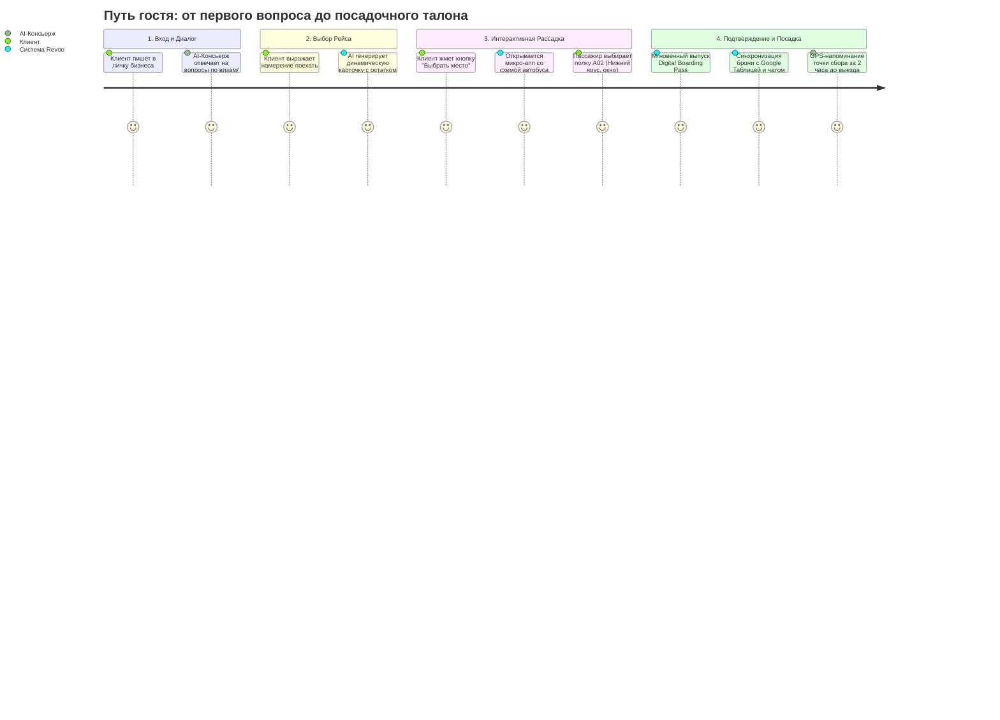
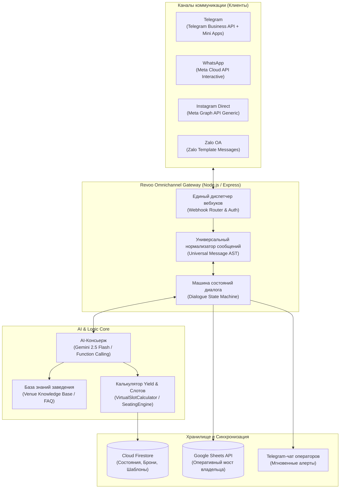
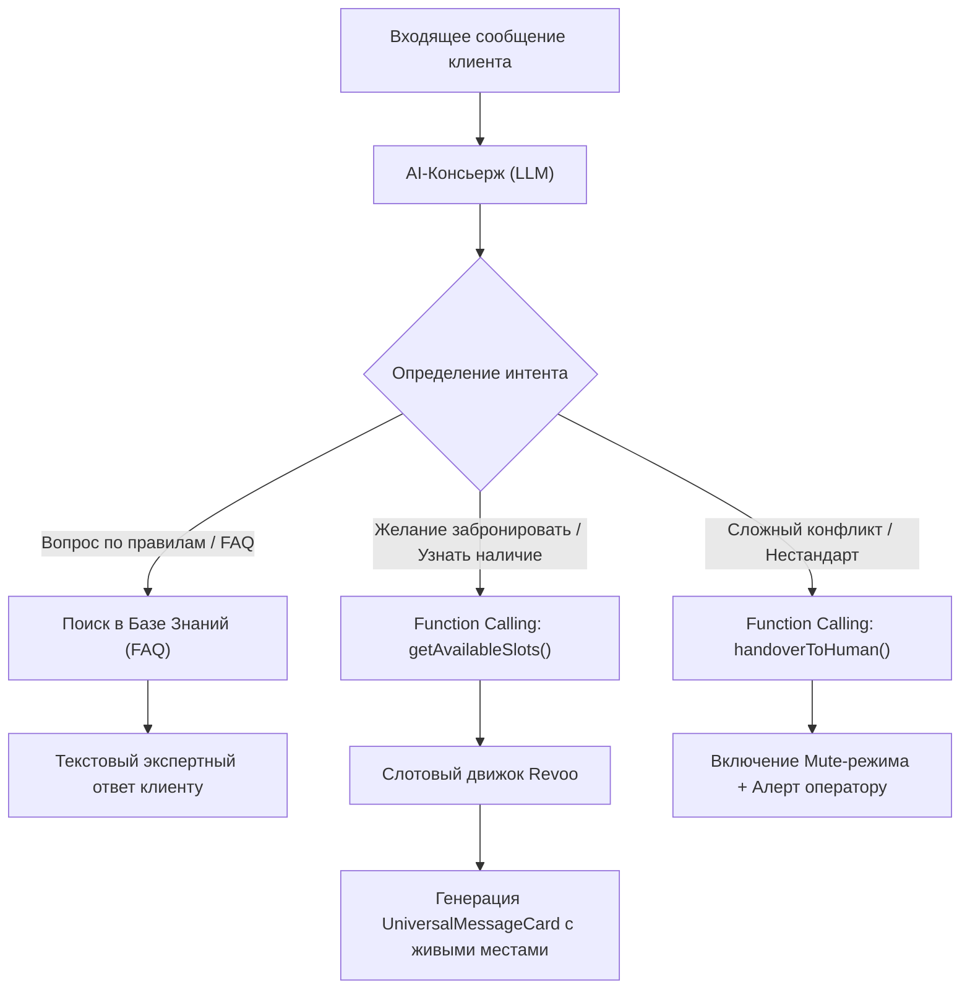
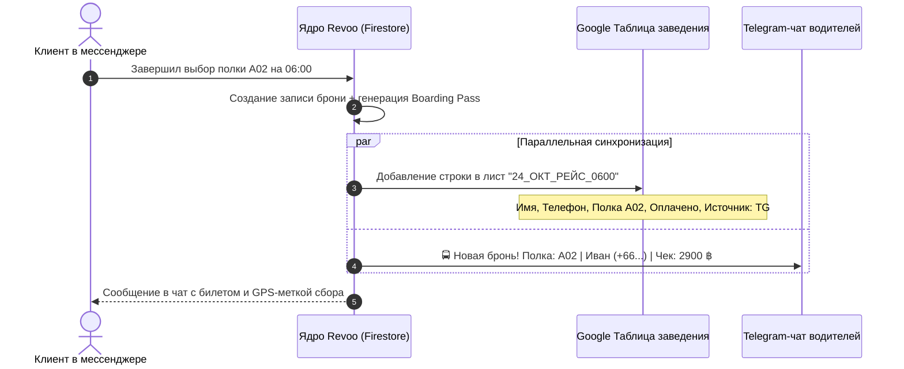

# SOURCE OF TRUTH: OMNICHANNEL MESSENGER AI CONCIERGE & DYNAMIC BOOKING SYSTEM
**Document ID:** `Bible_SoT/Omnichannel_Messenger_AI_Concierge_and_Booking_SoT.md`  
**Version:** 1.0 (PRODUCTION SPECIFICATION)  
**Status:** ARCHITECTURAL STANDARD  
**Module:** Revoo Services & Multi-Archetype Booking Ecosystem  

---

## 1. Введение и концептуальная парадигма (Core Paradigm)

### 1.1. Проблема традиционных решений на рынке
До настоящего момента индустрия автоматизации мессенджер-коммуникаций была разорвана на два изолированных и неэффективных лагеря:
1. **Кнопочные конструкторы (ManyChat, Salebot, BotHelp):**
   * Жесткие статические деревья решений (*«Нажмите 1, чтобы узнать цены; нажмите 2 для расписания»*).
   * Не способны понять живую естественную речь. Любой шаг в сторону от сценария приводит к поломке: *«Команда не распознана»*.
   * **Слепота к инвентарю:** не знают в реальном времени, сколько мест осталось в конкретном автобусе на 06:00 утра, не умеют рисовать интерактивные карты рассадки и не поддерживают динамические Yield-скидки.
   * **Кабальная экономика:** плата взимается за совокупный размер базы контактов ($15–$250+/мес на один аккаунт), наказывая бизнес за масштабирование.
2. **Изолированные LLM / ChatGPT-боты:**
   * Отлично ведут беседу, но **не имеют связи с операционной реальностью заведения**.
   * Галлюцинируют о тарифах, не могут гарантированно забронировать конкретное место `A02` и не имеют легального транзакционного шлюза.

### 1.2. Парадигма Revoo: Двухрежимный симбиоз в одном окне (Dual-Mode Architecture)
Система Revoo объединяет эти два мира в единую нативную среду мессенджера:

```
┌────────────────────────────────────────────────────────────────────────┐
│                   ЕДИНОЕ ОКНО ДИАЛОГА В МЕССЕНДЖЕРЕ                    │
├────────────────────────────────────────────────────────────────────────┤
│  🧠 РЕЖИМ 1: AI-Консьерж (Консультация и снятие возражений)            │
│  Клиент: "Привет! А с паспортом Казахстана штамп на границе поставят?  │
│           И во сколько сбор на сойке в Джомтьене?"                     │
│  AI: Мгновенно отвечает на естественном языке по верифицированной      │
│      базе знаний заведения (RAG / Knowledge Base).                     │
├────────────────────────────────────────────────────────────────────────┤
│  🎫 РЕЖИМ 2: Динамический Букинг (Транзакционное ядро)                 │
│  Клиент: "Отлично, запиши меня на завтра на утренний рейс"             │
│  AI вызывает Function Call -> на лету генерирует интерактивную         │
│  карточку-карусель с реальными остатками мест и персональной ценой:    │
│  ┌──────────────────────────────────────────────────────────────────┐  │
│  │ 🚍 06:00 Паттайя — Камбоджа • Слипер-бас VIP (Осталось 4 места)  │  │
│  │ 💰 2 900 ฿ (Ваша скидка постоянного гостя: -300 ฿ учтена)        │  │
│  │ [ ↗ Выбрать полку на схеме автобуса (A01-B18) ]                  │  │
│  └──────────────────────────────────────────────────────────────────┘  │
│  Клиент тапает -> открывается схема автобуса прямо в чате ->           │
│  выбор места -> мгновенное подтверждение и посадочный талон.           │
├────────────────────────────────────────────────────────────────────────┤
│  🛡️ СТРАХОВОЧНЫЙ РЕЖИМ: Human Handover (Менеджер)                      │
│  При нестандартных запросах бот мгновенно встает на паузу (Mute),      │
│  передавая контекст живому оператору в админский чат.                  │
└────────────────────────────────────────────────────────────────────────┘
```

> [!IMPORTANT]
> **Принцип нулевого трения (Zero-Friction In-Chat Commerce):**
> Клиент общается в своем привычном мессенджере (Telegram, WhatsApp, Instagram Direct, Zalo). Ему не требуется устанавливать сторонние приложения, переходить на тяжелые внешние сайты или проходить принудительную регистрацию по почте.

---

## 2. Путь пользователя (Customer Journey Map — CJM)



### Детализация шагов CJM:

#### Этап 1: Обнаружение и первичный контакт
* Гость пишет в личные сообщения аккаунта компании в Telegram (подключенного через Telegram Business API), в WhatsApp по номеру телефона или в Instagram Direct.
* Источник перехода: Google Карты, физический QR-код на стойке/листовке, рекламный таргетинг или органика.

#### Этап 2: Консультация через AI-Консьержа (Режим 1)
* Клиент задает неструктурированные вопросы: *«А кондиционер сильно дует?», «Сколько часов ехать до границы?», «У меня собака в переноске, можно?», «Где точка сбора на Central Festival?»*.
* AI-Консьерж отвечает строго в соответствии с системным промптом заведения и базой знаний (FAQ), сохраняя дружелюбный, экспертный тон.

#### Этап 3: Триггер бронирования и генерация карточки (Режим 2)
* Как только клиент формулирует намерение забронировать (*«Хочу на завтра», «Запиши двоих на пятницу»*), языковая модель распознает интент через **Function Calling** (`getAvailableSlots`).
* Слотовый движок Revoo проверяет:
  1. Реальное наличие свободных кресел/полок в сетке расписания на указанную дату.
  2. Персональный уровень скидки клиента (Time-Decay лояльность + горящие слоты Yield).
* Система генерирует в чат **интерактивную карточку или карусель** с реальными фото транспорта, точным временем выезда, остатком мест и финальной ценой.

#### Этап 4: Нативный выбор места в 1 тап
* Клиент нажимает кнопку на карточке:
  * В **Telegram**: открывается бесшовный **Telegram Mini App (TMA)** с интерактивной 2D-схемой салона (ветровое стекло, водитель, проходы, полки `A01..A18` нижнего яруса и `B01..B18` верхнего яруса).
  * В **WhatsApp / Instagram**: открывается нативный In-App Webview с облегченной схемой посадки.
* Место блокируется временным тайм-аутом (Lock TTL: 10 минут) для предотвращения овербукинга.

#### Этап 5: Оформление и подтверждение
* Клиент подтверждает имя и номер телефона (если бронирует в Telegram, номер может быть передан в 1 тап через контакт).
* Система генерирует **Цифровой посадочный талон (Digital Boarding Pass)** с QR-кодом, номером рейса, назначенным местом и гео-меткой точки сбора.
* Данные мгновенно синхронизируются с Google Таблицей заведения и падают в Telegram-чат операторов/водителей.

---

### 2.5. Двухпутевая омниканальная архитектура: Ветка А vs Ветка Б (Dual-Origin Architecture)

Система проектируется под сосуществование двух принципиально разных сценариев входа клиента:

```mermaid
flowchart TD
    subgraph FlowA["ВЕТКА А: Холодный веб-трафик (Google Карты, Сайт, Органика)"]
        A1["Гость открыл веб-страницу в браузере (Анонимный)"] --> A2["Выбрал рейс и место A02 в салоне"]
        A2 --> A3["Экран подтверждения:<br/>'Мост захвата в мессенджер'"]
        A3 --> A4["Кнопка: 'Получить билет и напоминание в [ Telegram ] [ WhatsApp ]'"]
        A4 --> A5["Deep Link: t.me/VenueBot?start=bk_98214<br/>Конвертация веб-гостя в постоянный контакт мессенджера!"]
        A5 --> A6["Бот в Telegram встречает по токену bk_98214:<br/>'Иван, ваше место A02 зафиксировано!'"]
    end

    subgraph FlowB["ВЕТКА Б: Клиент пришел ИЗ мессенджера (Telegram Business, WhatsApp)"]
        B1["Клиент общался с AI-Консьержем в чате"] --> B2["Тапнул кнопку 'Выбрать полку' (TMA / In-App Webview)"]
        B2 --> B3["Шторка схемы автобуса:<br/>Клиент УЖЕ авторизован через initData!"]
        B3 --> B4["Выбрал полку A02 -> Нажал 'Зафиксировать место'"]
        B4 --> B5["Telegram.WebApp.close() / window.close()<br/>Шторка мгновенно схлопывается!"]
        B5 --> B6["Возврат в диалог:<br/>Бот в этот же чат присылает готовый Boarding Pass"]
    end
```



#### Спецификация Ветки А: «Web-to-Messenger Bridge» (Захват лида)
* **Проблема классического веба:** Когда посетитель бронирует на сайте и оставляет телефон, сайт закрывается. Бизнес вынужден вручную дозваниваться или писать в WhatsApp «в холодную», рискуя попасть под спам-блокировку.
* **Решение Revoo:** В момент фиксации места на сайте вместо пассивной кнопки «Отправить заявку» клиенту предлагается 1-клик мост:
  * `[ ✈️ Получить билет и точку сбора в Telegram ]`
  * `[ 💬 Получить билет в WhatsApp ]`
* **Технический протокол Deep Linking:**
  * Сервер генерирует временный токен предброни: `booking_token = bk_98214` (срок жизни: 15 минут).
  * URL перехода: `https://t.me/VenueFleetBot?start=bk_98214`
  * Смартфон открывает приложение Telegram. Telegram передает боту параметр `/start bk_98214`.
  * Бэкграунд-хэндлер мгновенно связывает веб-сессию с `telegram_user_id` и присылает сформированный посадочный талон.
  * **Бизнес-результат:** Холодный клик из Google Maps навечно стал авторизованным подписчиком в Telegram/WhatsApp с открытым окном бесплатных повторных коммуникаций.

#### Спецификация Ветки Б: «Messenger-Originated Loop» (Бесшовный возврат в чат)
* **Инвариант UX:** Если клиент **уже находится в диалоге** с ботом или менеджером, ему **запрещено** показывать кнопки выбора других мессенджеров или требовать повторный ввод имени/телефона.
* **Контекстный детектор (`Context Sniffer`):**
  * Ссылка на Mini App или In-App Webview содержит маркер источника: `?source=tg_mini_app` или `?source=wa`.
  * В Telegram окружение передает объект `window.Telegram.WebApp.initDataUnsafe` с именем и username гостя.
* **Логика закрытия (Auto-Close & Push):**
  * Поля ввода скрыты или предзаполнены.
  * Единственная целевая кнопка: `[ Зафиксировать место A02 и вернуться в чат ]`.
  * При клике:
    1. Отправляется асинхронный запрос `POST /api/bookings/commit`.
    2. Вызывается `window.Telegram.WebApp.close()` (для Telegram) или закрытие окна для In-App браузера.
    3. Шторка схлопывается за 0.1 секунды. Клиент оказывается в исходном чате, куда бот за 300 мс доставляет сгенерированный посадочный талон и координаты сбора.

---

## 3. Техническая архитектура и платформенные адаптеры

Общая схема взаимодействия компонентов:



---

### 3.1. Платформенные адаптеры

#### 3.1.1. Telegram Business API (Bot API 7.2+)
* **Принцип подключения:** Владелец бизнеса за 30 секунд привязывает Revoo Bot в своем Telegram-клиенте: `Настройки` → `Telegram для бизнеса` → `Чат-боты`.
* **Автономия диалога:** Бот получает событие `business_message` с параметром `business_connection_id`. Он имеет право читать и отправлять сообщения **от имени бизнес-аккаунта** в личных диалогах с клиентами.
* **Интерфейс карточки:** Сообщение с медиа-баннером, форматированным текстом и инлайн-кнопкой `web_app`:
  ```json
  {
    "business_connection_id": "conn_12345",
    "chat_id": 987654321,
    "photo": "https://revoo.win/assets/sleeper_promo.jpg",
    "caption": "🚍 *Рейс 06:00 Паттайя — Камбоджа*\nСлипер-бас VIP • Свободно 4 места\n💰 Цена: 2 900 ฿",
    "parse_mode": "Markdown",
    "reply_markup": {
      "inline_keyboard": [
        [
          {
            "text": "↗ Выбрать полку (A01-B18)",
            "web_app": { "url": "https://revoo.win/services/seatmap?slotId=sat_0600&venueId=v1" }
          }
        ],
        [
          { "text": "💬 Задать вопрос оператору", "callback_data": "action_call_human" }
        ]
      ]
    }
  }
  ```

#### 3.1.2. WhatsApp Business (Meta Cloud API)
* Использует **Interactive Carousel Messages** и **CTA URL Buttons**:
  ```json
  {
    "messaging_product": "whatsapp",
    "recipient_type": "individual",
    "to": "+66XXXXXXXXX",
    "type": "interactive",
    "interactive": {
      "type": "cta_url",
      "header": { "type": "image", "image": { "link": "https://revoo.win/assets/sleeper.jpg" } },
      "body": { "text": "Рейс 06:00 Паттайя — Камбоджа. Свободно 4 места. Ваша цена: 2 900 ฿" },
      "action": {
        "name": "cta_url",
        "parameters": {
          "display_text": "Выбрать место",
          "url": "https://revoo.win/services/seatmap?slotId=sat_0600"
        }
      }
    }
  }
  ```

#### 3.1.3. Instagram Direct (Meta Graph API)
* Использует стандартный **Generic Template Carousel**:
  ```json
  {
    "recipient": { "id": "IG_USER_ID" },
    "message": {
      "attachment": {
        "type": "template",
        "payload": {
          "template_type": "generic",
          "elements": [
            {
              "title": "06:00 Слипер-бас Паттайя — Камбоджа",
              "image_url": "https://revoo.win/assets/bus_card.jpg",
              "subtitle": "Осталось 4 места • 2 900 ฿ (Скидка 300 ฿)",
              "buttons": [
                {
                  "type": "web_url",
                  "url": "https://revoo.win/services/seatmap?slotId=sat_0600",
                  "title": "Выбрать кресло"
                }
              ]
            }
          ]
        }
      }
    }
  }
  ```

---

### 3.2. Универсальный формат сообщений (Normalized Message AST)

Для того чтобы бизнес-логика не зависела от протокола конкретного мессенджера, в ядре системы сообщения формируются в нейтральном JSON-формате:

```typescript
interface UniversalMessageCard {
  title: string;
  subtitle: string;
  imageUrl?: string;
  badges?: string[];            // e.g. ["Осталось 3 места", "-15% Скидка"]
  actionUrl: string;            // Прямая ссылка на интерактивную карту рассадки
  actionText: string;           // e.g. "Выбрать полку A01-B18"
  secondaryActionText?: string; // e.g. "Позвать человека"
}

interface UniversalMessagePayload {
  recipientId: string;
  channel: 'telegram_business' | 'whatsapp' | 'instagram' | 'zalo';
  textHeader?: string;
  cards: UniversalMessageCard[];
}
```

Специализированный адаптер (`TelegramAdapter`, `WhatsAppAdapter`, `InstagramAdapter`) принимает объект `UniversalMessagePayload` и транслирует его в байты протокола целевой платформы.

---

### 3.3. Логика работы AI-Консьержа и Function Calling

AI-модуль (Gemini 2.5 Flash / Claude) функционирует в режиме строгого соблюдения роли:



#### Доступные системные инструменты (Function Tools):
1. `getAvailableSlots(date, routeId)`: опрашивает базу свободных рейсов и формирует массив доступных автобусов с количеством незанятых кресел.
2. `calculateYieldPrice(guestId, slotId)`: рассчитывает финальную цену с учетом Time-Decay скидки гостя и правил ценообразования дня.
3. `reserveSeatSlot(slotId, seatNumber, guestData)`: инициирует временную блокировку кресла.
4. `handoverToHuman(reason)`: переводит диалог на дежурного менеджера заведения.

---

## 4. Визуальный граф-редактор сценариев (Flow Builder UI)

Для того чтобы владелец бизнеса мог самостоятельно настраивать приветствия, промо-акции и цепочки сообщений, в панель управления интегрируется легковесный визуальный граф-редактор на базе **`@xyflow/react` (React Flow)**.

### 4.1. Доступные типы нод (Блоков графа):
1. 🟢 **Триггер (Entry Node):**
   * Первое входящее сообщение (Greeting).
   * Реакция на сторис / ключевое слово (*«Рейс»*, *«Виза»*, *«Бордер»*).
   * Вход по QR-коду с уличного флаера.
2. 💬 **Сообщение + Кнопки (Message Node):**
   * Текст сообщения с поддержкой переменных (`{guest_name}`, `{vip_discount}`).
   * Инлайн-кнопки перехода по веткам графа.
3. 🚍 **Динамическая карусель (Dynamic Catalog Node):**
   * Автоматически подтягивает рейсы на завтра/послезавтра из базы заведения.
   * Рендерит карточки с фотографией автобуса, префиксом яруса (`A01-A18`) и кнопкой мгновенного выбора мест.
4. 🔀 **Условие (Condition Node If/Else):**
   * *«Если гость новый»* → направить на ветку с промокодом на первую поездку.
   * *«Если постоянный гость»* → показать эксклюзивный тариф с VIP-скидкой.
5. 👤 **Перевод на оператора (Human Handover Node):**
   * Постановка бота на паузу (Mute) на 60 минут.
   * Отправка мгновенного push-уведомления в рабочий Telegram-чат менеджеров со ссылкой на диалог.

---

## 5. Протокол сосуществования с человеком (Human Handover & Silent Mute)

Один из главных страхов бизнеса — что бот будет перебивать живого менеджера, отправляя шаблонные ответы невпопад.

### Архитектурные правила Mute-протокола:
1. **Автоматический детект активности менеджера:**
   * Если живой оператор заходит в чат со своего телефона/десктопа и отправляет сообщение клиенту вручную, система регистрирует событие `outgoing_message_from_admin`.
   * Бот **немедленно встает на паузу (Mute)** для этого конкретного диалога на **45 минут** (настраивается в веб-панели).
2. **Продление тишины:**
   * Каждое последующее сообщение от менеджера сбрасывает таймер тишины обратно на 45 минут.
3. **Автоматический возврат на дежурство:**
   * Если в течение 45 минут сообщений от менеджера не было, а клиент снова написал новый вопрос — бот корректно возвращается к автоответу.
4. **Принудительные команды управления в чате:**
   * Менеджер может прямо в переписке отправить служебный шорткод (видимый только системе):
     * `/mute` — выключить бота для этого контакта на 24 часа.
     * `/unmute` — немедленно вернуть бота в строй.

---

## 6. Двухсторонняя синхронизация с Google Таблицами и чатом водителей

Для транспортных компаний и салонов красоты Google Таблицы остаются ключевым операционным мостом.



---

## 7. Сравнительная экономика: Свой движок vs ManyChat

| Параметр | ManyChat (как внешняя прокладка) | Собственный движок Revoo |
| :--- | :--- | :--- |
| **Стоимость на 10 000 контактов** | ~$65 / мес на **каждое** заведение | **0 $** (хранится в нашей базе) |
| **Стоимость на 50 000 контактов** | ~$235 / мес на **каждое** заведение | **0 $** |
| **Совокупные расходы на 50 заведений** | **$3 000 – $6 000+ / месяц чужому сервису** | **~$40 / месяц** (серверные ресурсы) |
| **Тарификация в Telegram** | Платная подписка за контакты | **100% бесплатно** (лимиты отсутствуют) |
| **Тарификация в Instagram Direct** | Платная подписка за контакты | **100% бесплатно** (Meta не берет плату) |
| **Связь с реальными остатками мест** | ❌ Нет (нужен костыльный Zapier/Make) | ✅ **Нативно «из коробки» за < 2 мс** |
| **Интерактивная карта салона** | ❌ Не поддерживается | ✅ **Telegram Mini App / In-App Webview** |

---

## 8. План внедрения (Implementation Roadmap)

1. **Фаза 1: Ядро нормализатора и Telegram Business API (Неделя 1)**
   * Реализация `UniversalMessageNormalizer` на бэкенде.
   * Подключение вебхуков `business_message` Telegram Business.
   * Рендеринг карточек рейсов с кнопкой открытия схемы автобуса (`VehicleSeatMap.jsx`).
2. **Фаза 2: Симбиоз с AI-Консьержем (Неделя 2)**
   * Подключение базы знаний (FAQ) конкретного заведения.
   * Настройка Function Calling: перевод намерения гостя в вызов карточки букинга.
   * Тестирование протокола Mute (молчание бота при ответе менеджера).
3. **Фаза 3: Визуальный конструктор сценариев (Неделя 3)**
   * Встраивание экрана Flow Builder на базе React Flow в админ-панель заведения.
   * Настройка кастомных нод (Текст, Карусель, Условие, Перевод на человека).
4. **Фаза 4: Расширение на Meta Cloud API (WhatsApp & Instagram) (Неделя 4)**
   * Прямое подключение Meta Cloud API без промежуточных сторонних сервисов.
   * Поддержка WhatsApp Interactive Carousels и Instagram Direct Generic Templates.

---

## 9. Заключение
Данная архитектура превращает обычный мессенджер из пассивного чата в **высококонверсионный автономный канал прямых продаж**. Она гарантирует полную независимость платформы от зарубежных SaaS-конструкторов, защищает экономику заведений от абонентских поборов за базу контактов и обеспечивает клиентам лучший на рынке пользовательский опыт в 1 тап.
