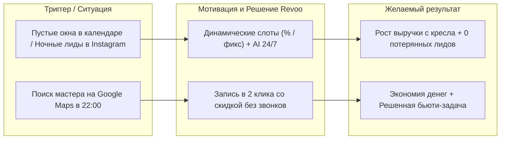
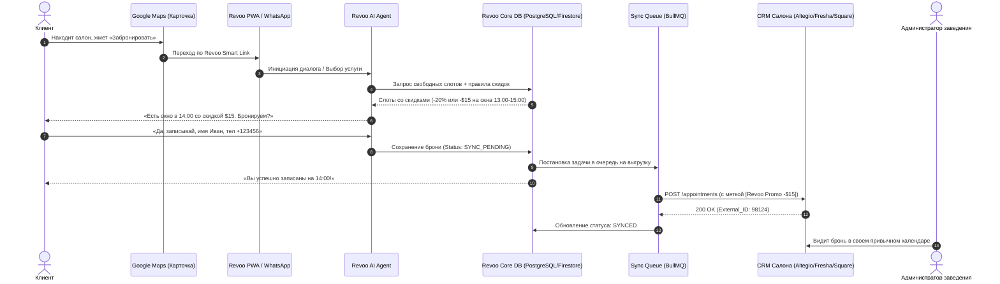
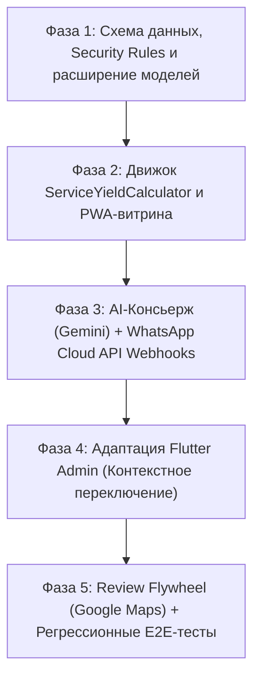

# Revoo Services: Архитектура модуля для сервисного бизнеса и перехвата трафика из Google Maps

**Версия:** 1.0 (Draft / Architecture Specification)  
**Статус:** Спроектировано для согласования  
**Целевой сегмент:** Сервисные локальные бизнесы (барбершопы, салоны красоты, массажные студии, клиники, стоматологии, детейлинг-центры).  
**Назначение:** Автономная экосистема перехвата трафика из Google Maps, динамического заполнения простаивающих слотов (Yield Management) со скидками в % и фиксированных суммах, 24/7 AI-бронирования через омниканальные мессенджеры и генерации отзывов в Google Maps без смены текущей CRM бизнеса.

---

## 1. Бизнес-цели и концепция (Executive Summary)

Главная проблема любого сервисного бизнеса — **«сгорающее время» мастеров и оборудования (Perishable Inventory)**. В отличие от ритейла или ресторанов, где непроданный товар можно реализовать позже, пустующее кресло барбера или массажный кабинет во вторник в 14:00 приносит **100% невосполнимый убыток**. При этом аренда и базовая ставка персонала продолжают начисляться.

Вторая проблема — **потеря входящего трафика из Google Maps и Instagram**:
- Потенциальный клиент ищет услугу на карте или в соцсетях поздно вечером или во время работы, когда звонить неудобно.
- Администраторы салона перегружены оффлайн-гостями, долго отвечают в директ или спят в нерабочие часы. Задержка ответа более 15 минут приводит к уходу 70% клиентов к конкурентам.
- Традиционные системы онлайн-записи (YClients, Fresha, Altegio) пассивны: они представляют собой обычные цифровые шахматки и не умеют стимулировать спрос на непопулярные часы.

### Решение Revoo Services:
1. **Перехват трафика с Google Maps без внедрения тяжелых интеграций:** Бесшовный вход через `Appointment Link` (ссылку для записи) на лёгкую витрину или прямой запуск диалога в WhatsApp.
2. **Динамический Yield Management (Управление доходностью слота):** Автоматическое начисление скидок на «мертвые» часы — **как в процентах, так и в фиксированных суммах валюты** (например, `-500 ₽` / `-$15` или `-25%`).
3. **24/7 AI-Консьерж (Omnichannel Booking Agent):** Прием записей на естественном языке через Web-виджет, WhatsApp, Instagram Direct и Google Business Chat.
4. **Легкая архитектура интеграции (Middleware Overlay):** Revoo не требует смены CRM. Данные пишутся в собственную БД Revoo и автоматически транслируются в текущую CRM бизнеса (Altegio, YClients, Fresha, Square или Google Calendar).
5. **Review Flywheel (Маховик репутации):** Автоматическая фильтрация оценок: довольные клиенты направляются оставлять 5 звезд в Google Maps, а негатив перехватывается управляющим до публикации.

---

## 2. Jobs to be Done (JTBD) Framework



### 2.1. JTBD для локального бизнеса (Владельцы и управляющие)
* **Core Job (Максимизация выручки с часа):**  
  *«Когда у моих мастеров есть дыры в расписании в будни или из-за внезапных отмен, я хочу, чтобы система автоматически стимулировала запись на эти слоты с контролируемой скидкой, чтобы сократить время простоя и повысить общую маржинальность бизнеса без слива рекламного бюджета.»*
* **Operational Job (Безупречный ночной и пиковый фронт-офис):**  
  *«Когда клиенты пишут нам ночью или когда администратор занят расчетом гостя, я хочу, чтобы умный AI-ассистент мгновенно подхватывал диалог, отвечал на вопросы и записывал клиента прямо в наш текущий календарь, чтобы мы не теряли клиентов из-за медленных ответов.»*
* **Reputational Job (Органический рост в Google Maps):**  
  *«Когда клиент выходит из салона довольным, я хочу автоматически получать от него 5 звезд на Google Maps, чтобы наша карточка поднималась в топ выдачи района без серых накруток.»*

### 2.2. JTBD для конечных клиентов (Гости заведений)
* **Convenience Job (Быстрая запись без барьеров):**  
  *«Когда я нахожу удобный салон на Google Maps, я хочу сразу же забронировать нужное время в чате или в пару тапов, не звоня голосом и не скачивая громоздкие приложения, чтобы мгновенно закрыть задачу.»*
* **Smart Saver Job (Выгода за гибкость графика):**  
  *«Когда у меня есть свободное время днем, я хочу получить ощутимую выгоду (в процентах или фиксированной скидке) за выбор менее загруженного времени, чтобы чувствовать себя умным клиентом, получая услугу премиум-качества дешевле.»*

### 2.3. JTBD для Супер-Администратора Revoo (Onboarding & Instant Launch)
* **Zero-Friction Launch Job:**  
  *«Когда новый партнер из сферы услуг подключается к платформе Revoo, я как супер-администратор хочу завести карточку заведения в админ-панели, переключить бизнес-профиль на `services`, указать телефон менеджера и Google Place ID, и в один клик инициализировать карточку со стартовым пакетом мастеров, услуг и yield-правил, чтобы моментально передать партнеру готовую PWA-ссылку для Google Maps и сразу приступить к тестированию AI-консьержа.»*

---

## 3. Технический стек модуля Revoo Services

| Слой | Технологии | Назначение |
| :--- | :--- | :--- |
| **Frontend Витрины (Guest App)** | React 18, Vite, Tailwind CSS, Lucide Icons | Легковесная мобильная PWA-витрина и Web-Chat консьерж (открытие < 1 сек). |
| **Admin Panel (B2B)** | Flutter Web (Dart) | Личный кабинет владельца (настройки слотов, тиров скидок, CRM и WhatsApp). |
| **Backend & Cloud Services** | Firebase (Cloud Firestore, Cloud Functions Node.js v20) | Авторизация, синхронизация слотов, хранение бизнес-логики. |
| **Очереди и надежность** | Redis + BullMQ (или Cloud Tasks) | Гарантированная доставка записей во внешние CRM с Exponential Backoff. |
| **AI-Агент (Консьерж)** | Google Gemini 1.5 Pro / Flash (Function Calling) | Распознавание свободной речи, выбор слотов, диалоговый букинг. |
| **Мессенджеры** | Meta WhatsApp Cloud API (Embedded Signup), Instagram Graph API | Омниканальный прием бронирований 24/7. |
| **Интеграционный слой** | Modular Adapter Engine (REST, GraphQL, iCal/Google Calendar) | Синхронизация с YClients/Altegio, Square, Fresha, Google Calendar. |

---

### 3.1. Принцип строгой модульности и файловая структура (Strict Modularity Pattern)

Для обеспечения максимальной управляемости, простоты тестирования и возможности изолированного редактирования отдельных компонентов без риска сломать всю систему, код сервисного модуля **принципиально декомпозируется на независимые микромодули**:

```text
FriendlyCode/
├── src/modules/services/                       # Изолированный React-модуль витрины
│   ├── components/
│   │   ├── ServiceCard.jsx                     # Атомарная карточка услуги
│   │   ├── ServiceCategoryTabs.jsx             # Табы категорий
│   │   ├── MasterSelector.jsx                  # Выбор специалиста/мастера
│   │   ├── SlotGrid.jsx                        # Сетка доступных часов со скидками
│   │   ├── BookingModal.jsx                    # Модальное окно подтверждения и телефона
│   │   └── AIConciergeWidget.jsx               # Плавающий виджет AI-диалога
│   ├── logic/
│   │   ├── ServiceYieldCalculator.js           # Изолированный калькулятор (% и фикс)
│   │   └── slotAvailabilityFilter.js           # Валидация и фильтрация доступных окон
│   ├── services/
│   │   └── bookingApiService.js                # Клиентский слой сохранения броней в Firestore
│   └── index.jsx                               # Главная точка входа витрины (ServiceStorefront)
│
├── functions/services/                         # Модульный Node.js бэкенд (Cloud Functions)
│   ├── adapters/
│   │   ├── IBookingAdapter.js                  # Базовый интерфейс адаптера
│   │   ├── googleCalendarAdapter.js            # Коннектор к Google Calendar API
│   │   └── altegioAdapter.js                   # Коннектор к Altegio / YClients API
│   ├── ai/
│   │   ├── geminiAgent.js                      # Инициализация и системный промпт Gemini
│   │   └── toolsDefinition.js                  # Function Calling схемы (getSlots, bookSlot)
│   ├── webhooks/
│   │   ├── whatsappCloudWebhook.js             # Изолированный обработчик Meta WhatsApp
│   │   └── instagramWebhook.js                 # Обработчик Instagram Direct
│   └── bookingSyncWorker.js                    # Фоновый воркер синхронизации записей в CRM
│
├── admin/lib/
│   ├── core/models/services/                   # Изолированные модели данных (Dart)
│   │   ├── service_item_model.dart             # Модель услуги
│   │   ├── staff_member_model.dart             # Модель мастера
│   │   ├── service_yield_rule_model.dart       # Модель правил динамических скидок
│   │   └── service_booking_model.dart          # Модель бронирования
│   └── features/services/presentation/         # Модульные экраны админ-панели Flutter
│       ├── screens/
│       │   ├── services_catalog_screen.dart    # Модерация каталога услуг
│       │   ├── staff_management_screen.dart    # Управление мастерами и сменами
│       │   ├── yield_rules_screen.dart         # Конструктор скидок (% и фикс)
│       │   └── crm_integration_screen.dart     # Настройки подключения Altegio/Google Cal
│       └── widgets/
│           ├── service_editor_dialog.dart      # Модальный редактор услуги
│           └── time_window_picker.dart         # Селектор временных окон для скидок
```

#### Правила архитектурной гигиены:
1. **Single Responsibility:** Каждый файл отвечает строго за одну задачу (один экран, одна модель, один адаптер). Запрещены монолитные файлы > 300 строк.
2. **Нулевое загрязнение ядра HoReCa:** Существующий файл `src/GoogleMapsPreLanding.jsx` не раздувается сервисным кодом — он лишь проверяет `venue.businessType === 'services'` и монтирует независимый модуль `<ServiceStorefront />`.
3. **Изолированное тестирование:** Любой модуль (например, калькулятор скидок или коннектор Google Calendar) может тестироваться изолированно без запуска всего приложения.


---

## 4. Сквозная схема взаимодействия (End-to-End Workflow)



---

## 5. Логика начисления скидок (Dynamic Yield Management Engine)

В сервисных бизнесах средний чек варьируется от $20 (мужская стрижка) до $500 (сложное окрашивание, курсы массажа, стоматология). Поэтому единый процент не подходит:
* На услугу за $20 скидка 20% ($4) привлекательна для клиента и безопасна для салона.
* На процедуру за $400 скидка 20% ($80) может быть избыточной и уничтожать маржу мастера.

### 5.1. Режимы дисконтирования в Revoo Services
Система поддерживает **гибридные правила дисконтирования**:

```json
{
  "discount_rule": {
    "rule_id": "rule_weekday_dead_hours",
    "name": "Дневные часы будней",
    "days_active": ["mon", "tue", "wed", "thu"],
    "time_window": { "from": "11:00", "to": "16:00" },
    "discount_type": "ABSOLUTE_OR_PERCENTAGE", 
    "calculation_mode": "FIXED_AMOUNT", 
    "value": 500,
    "currency": "RUB",
    "min_service_price_threshold": 1500,
    "max_discount_cap": 1000
  }
}
```

#### Типы расчета:
1. **Процентный (Percentage-Based):**
   * Пример: `-15%` или `-25%` на утренние часы.
   * Опционально: `Max Discount Cap` (потолок скидки в деньгах, например, *не более 1 500 ₽ / $20*).
2. **Абсолютный (Fixed Amount):**
   * Пример: Скидка `500 ₽` / `$15` / `50 AED` при выборе непопулярного окна.
   * Идеально для клиник и премиальных салонов, чтобы не размывать престиж бренда огромными процентами.
3. **Многоуровневые тиры (Tiered Yield):**
   * **Тир 1 (Горящий слот / Flash Slot):** До слота осталось менее 3 часов $\rightarrow$ максимальный дисконт (например, `-30%` или `-$25`).
   * **Тир 2 (Off-Peak регулярный):** Будни с 11:00 до 16:00 $\rightarrow$ умеренный дисконт (`-15%` или `-$10`).
   * **Тир 3 (Normal / Standard):** Будни вечер $\rightarrow$ базовая цена без скидки (`0%`).
   * **Тир 4 (Peak Surcharge / Опционально):** Пятница вечер и суббота $\rightarrow$ стандартная цена либо наценка `+10%` за топ-мастера.

---

## 6. Каналы захвата трафика и AI-Консьерж

### 6.1. Google Maps без интеграции с Google Business Profile API
* Заведению не требуется давать доступ разработчика к Google Cloud или делегировать права на карточку.
* Владелец один раз указывает персональную ссылку Revoo в стандартном поле профиля Google Maps: **«Ссылка для записи» (Appointment URL)**.
* **Smart Action Link:**
  * Ссылка формата `revo.link/{venue_slug}` определяет устройство пользователя.
  * На мобильном предлагает выбор: мгновенный чат в **WhatsApp** или **Web-витрина**.
  * Для прямого прыжка в WhatsApp формируется ссылка:  
    `https://wa.me/{phone}?text={urlencoded_prompt}` с готовой фразой *«Здравствуйте! Нашел вас на Google Maps, хочу записаться со скидкой»*.

### 6.2. WhatsApp Cloud API через Meta Embedded Signup
* **Время подключения:** 90 секунд в личном кабинете Revoo.
* Владелец нажимает кнопку **«Подключить WhatsApp через Facebook»**.
* В официальном pop-up окне Meta выбирает или создает WABA (WhatsApp Business Account) и подтверждает номер телефона через 6-значный SMS-код.
* Revoo автоматически получает `System User Access Token` и регистрирует вебхуки. Никакой ручной возни с Twilio или JSON-ключами.

### 6.3. Интеграция с Instagram Direct
* Подключение через Meta Graph API.
* AI-агент перехватывает:
  1. Личные сообщения (Direct).
  2. Ответы на Stories (например, по кодовому слову *«СЛОТ»*).
  3. Комментарии под постами (с авто-переходом в Direct).

### 6.4. Архитектура профиля и базы знаний заведения (Dual-Layer Knowledge Base)
Под каждое заведение формируется изолированный контейнер знаний в Firestore:

```text
venues/{venueId}/ai_knowledge/
├── deterministic_data (Структурированная база — точные факты)
│   ├── working_hours: { mon: "10:00-21:00", ... }
│   ├── services_matrix: [ { name, duration, price, contraindications } ]
│   ├── staff_roster: [ { name, working_days, specializations } ]
│   └── yield_rules: [ { time_window, discount_value, type } ]
│
├── semantic_memory (Семантическая база — RAG / FAQ для ответов на вопросы)
│   ├── location_and_parking: "Парковка во дворе под шлагбаум, код 1234..."
│   ├── venue_policies: "С животными до 5 кг можно. Опоздание более 15 мин — перенос."
│   ├── equipment_and_cosmetics: "Работаем на косметике Davines и Kevin Murphy..."
│   └── custom_instructions: "Предлагать гостям капучино с корицей, общаться на 'вы'..."
│
└── change_logs (История команд владельца с аудитом изменений)
```

### 6.5. Flow первичного онбординга: «Интервью за 3 минуты»
Вместо заполнения рутинных 50 полей форм запускается интерактивное **AI Onboarding Interview** в Telegram-боте владельца или прямо в мобильной веб-админке:
1. **Шаг 0 (Авто-скрейпинг Google Maps):** AI заранее вытягивает из карточки адрес, текущие часы работы, рейтинг, отзывы и фотографии.
2. **Шаг 1 (Интерактивный блиц-диалог голосом или текстом):**
   * *Вопрос 1 (Тон общения):* «На «ты» (по-дружески) или на «вы» (уважительно-сервисно)?»
   * *Вопрос 2 (Парковка):* «Что отвечать гостям про парковку и проезд?»
   * *Вопрос 3 (Ограничения):* «Есть ли правила по животным, детям или опозданиям?»
3. **Шаг 2 (Цифровой паспорт):** AI синтезирует ответы в «Цифровой паспорт заведения», владелец жмет «Подтверждаю», и агент готов к работе.

### 6.6. Управление заведением на естественном языке (Manager-to-AI Chat)
Владелец и управляющие добавляются в защищенный служебный канал (Telegram-бот / WhatsApp) с разграничением прав (`role: owner | manager`):
* **Команды на лету:** Владелец пишет: *«В эту пятницу открываемся на час позже, с 11:00»* или *«Мастер Алексей заболел, заблокируй его слоты на сегодня и завтра»*.
* **Intent Recognition & Two-Way Confirmation:** AI распознает намерение, формирует точный ответ с кнопкой подтверждения (*«Понял: в пятницу 24 октября работаем с 11:00 до 22:00. Применить?»*), и только после подтверждения вызывает мутацию в Firestore/CRM.
* **Audit Trail:** Все изменения фиксируются в `change_logs` для предотвращения несанкционированных сбоев.

### 6.7. JTBD обучения и управления AI-Агентом
* **JTBD Владельца:** *«Когда в заведении что-то меняется, я хочу просто надиктовать голосовое или скинуть строчку в Telegram ассистенту, чтобы не открывать ноутбук и не копаться в настройках админки.»*
* **JTBD AI-Агента:** *«Когда управляющий дает мне указание, я должен безошибочно распознать команду, перепроверить двусмысленности через подтверждение и обновить факты, чтобы никогда не дезинформировать гостей.»*


---

## 7. Модель данных и архитектура адаптеров CRM

### 7.1. Каноническая схема данных (Canonical Schema)

```text
Tenants (Заведения)
├── id: string
├── name: string
├── business_type: "service" | "restaurant"
├── currency: "USD" | "RUB" | "AED" | "VND"
├── discount_settings: DiscountConfig
├── crm_integration: {
│     provider: "altegio" | "fresha" | "square" | "google_calendar" | "standalone",
│     api_credentials: EncryptedString,
│     sync_frequency_minutes: number
│   }
└── ai_agent_settings: {
      bot_name: string,
      tone_of_voice: string,
      rules: string[]
    }

Services (Каталог услуг)
├── id: string
├── title: string
├── duration_minutes: number
├── base_price: number
├── max_discount_amount: number?
└── external_service_id: string

Staff (Мастера / Ресурсы)
├── id: string
├── name: string
├── role: string
├── rating: number
└── external_staff_id: string

Bookings (Записи)
├── id: string
├── tenant_id: string
├── client_name: string
├── client_phone: string
├── service_id: string
├── staff_id: string
├── start_time: timestamp
├── end_time: timestamp
├── original_price: number
├── final_price: number
├── discount_applied: { type: "PERCENT" | "FIXED", amount: number }
├── source: "google_maps" | "instagram" | "whatsapp" | "web"
├── status: "created" | "sync_pending" | "synced" | "completed" | "no_show"
└── external_booking_id: string?
```

### 7.2. Архитектура слоя адаптеров (Adapter Engine)
Каждая внешняя система реализует контракт `IBookingAdapter`:
* `AltegioAdapter` (YClients / Altegio API v2)
* `FreshaAdapter` (Fresha Partner API)
* `SquareAdapter` (Square Appointments API)
* `GoogleCalendarAdapter` (Google Calendar API v3 — двустороннее чтение событий и создание слотов)
* `StandaloneAdapter` (для работы без сторонних CRM)

### 7.3. Концепция виртуальных слотов на лету (On-Demand Virtual Slots)
Чтобы база данных не перегружалась миллионами пустых записей на месяцы вперед, в системе **физически не хранятся пустые слоты**:
1. В базе хранятся только **два компактных факта**:
   * Базовый график мастера (1 строчка: `mon-fri 10:00-20:00`).
   * Реально занятые интервалы (`bookings` со статусом `confirmed`).
2. При запросе слотов (от пользователя или AI) алгоритм за 1 миллисекунду в оперативной памяти (RAM) вычисляет разность:
   $$\text{Свободные окна} = \text{Интервал смены} \setminus \bigcup \text{Занятые брони}$$
3. На полученные окна «на лету» накладывается чистая математическая функция скидки. В базу данных уходит ровно **одна операция чтения** вместо сотен.

### 7.4. Федеративная модель и умное кэширование (Smart Proxy)
Поскольку график мастеров и отпуска уже ведутся в родной CRM клиента (Altegio/YClients/Fresha/Google Cal), Revoo не дублирует эти данные:
* При обращении клиента Revoo запрашивает актуальную занятость через API сторонней CRM.
* Результат кэшируется в оперативной памяти (In-Memory / Redis) на **60–90 секунд**.
* Все повторные обращения клиентов в течение этого окна обслуживаются мгновенно без нагрузки на стороннюю CRM и внутреннюю базу данных.

### 7.5. Математика нагрузки и объема данных (Lean Database Footprint)
Расчет реального объема данных на **1 среднее заведение (5 мастеров, 300 броней в месяц)**:

| Сущность | Количество в месяц | Размер 1 записи | Объем в месяц |
| :--- | :--- | :--- | :--- |
| **Профиль заведения и AI-паспорт** | 1 документ | ~3 КБ | **3 КБ** |
| **Каталог услуг (20 позиций)** | 1 документ (массив) | ~4 КБ | **4 КБ** |
| **Мастера и графики (5 человек)** | 5 документов | ~1 КБ | **5 КБ** |
| **Правила скидок (Yield Rules)** | 1 документ | ~1 КБ | **1 КБ** |
| **Записи через Revo (300 броней)** | 300 документов | ~0.8 КБ | **~240 КБ** |
| **Логи диалогов AI с клиентами** | 300 диалогов | ~2 КБ | **~600 КБ** |
| **ИТОГО на 1 заведение в месяц:** | — | — | **< 1 Мегабайта** |

* **100 заведений** создают всего **~85 МБ в месяц**.
* **1 000 заведений** за целый год работы занимают менее **10 ГБ**.
* Вся база с колоссальным запасом масштабируется на базовых тарифах облака ($25–$50/мес на всю международную сеть).


---

## 8. Архитектура админ-панели: Единая платформа vs Разные панели

### Анализ вариантов:
* **Вариант А: Две совершенно разные кодовые базы админ-панелей.**
  * *Минусы:* Дублирование кода авторизации, биллинга, профилей, управления правами сотрудников, общих компонентов дизайна. При каждом обновлении UI придется вносить правки дважды.
* **Вариант Б: Единая админ-панель с контекстно-зависимым рабочим пространством (Dynamic Context-Aware Admin).**
  * *Плюсы:* Единая база Flutter Web, общая система авторизации и биллинга. При создании заведения владелец выбирает тип: `Ресторан (F&B)` или `Сервисный бизнес (Services)`.
  * *Интерфейс подстраивается на 100%:* 
    * Для ресторана скрываются слоты и мастера, открываются меню, столы, зоны доставки и интеграция с агрегаторами.
    * Для барбершопа/клиники скрываются блюда и модификаторы, открываются мастера, расписание, динамические тиры слотов, AI-консьерж и интеграция с CRM (Altegio/Fresha).

> **Вердикт:** Рекомендуется **Вариант Б (Единая кодовая база с модульными экранами)**. Для пользователя это выглядит как узкоспециализированный инструмент под его нишу, а для разработки исключает двойные расходы на поддержку.

---

## 9. Матрица разрешения конфликтов с ядром Revo (HoReCa vs Services Isolation)

Для гарантии 100% обратной совместимости и нулевой регрессии в работающем ресторанном модуле онлайн-доставки внедряется **архитектурная изоляция по флагу `venue.businessType`**.

| № | Область / Механика | Логика HoReCa / Delivery | Логика Revo Services | Механика устранения конфликта в коде |
| :-: | :--- | :--- | :--- | :--- |
| **1** | **Принцип начисления скидки** | **Time-Decay:** зависит от дней с прошлого заказа (`diffDays`). Первый визит = минимальный Тир 1. | **Slot-Yield:** зависит от загрузки слота времени (вторник 14:00 = скидка). Новый гость получает скидку сразу. | Разделение калькуляторов: ядро `RewardCalculator.js` для ресторанов остается нетронутым. Для сервисов создается `ServiceYieldCalculator.js`, вызываемый строго при `businessType === 'services'`. |
| **2** | **Формат скидки** | Строго целые проценты (`%`). | Проценты (`%`) ИЛИ фиксированная сумма (`500 ₽`, `$15`, `50 AED`). | Введение `discountType: 'percentage' \| 'fixed'` и калькуляция: `finalPrice = discountType === 'fixed' ? Math.max(0, price - value) : price * (1 - value / 100)` с поддержкой `max_discount_cap`. |
| **3** | **Процесс чекаута и платежи** | Обязательная оплата/заказ: VietQR, Stripe, COD $\rightarrow$ запись в `orders`. | Бронирование без списания средств Revo (оплата на месте). | Для сервисов чекаут завершается шагом «Подтверждение брони» с записью в коллекцию `bookings` вместо `orders` без требования платежного шлюза. |
| **4** | **Идентификация гостя** | Анонимный вход (`signInAnonymously`), телефон только при доставке на дом. | Телефон строго обязателен для синхронизации с внешней CRM (YClients, Fresha). | Валидатор клиентской формы блокирует отправку брони без валидного E.164 номера телефона. |
| **5** | **Каталог позиций** | `GmMenuItem` (блюда, категории, порции, цены агрегаторов). | `GmServiceItem` (услуги, длительность, привязка к мастерам). | Расширение `GmServiceItem` полями `durationMinutes`, `staffIds`, `externalServiceId`. Рендеринг специализированного списка услуг вместо меню доставки. |
| **6** | **База данных и Security Rules** | Доступ открыт только к `orders`, `visits`, `pos_sessions`. | Требуется запись в `bookings`, `services`, `staff`. | Добавление явных правил доступа для коллекции `bookings` в `firestore.rules`. |
| **7** | **UX и Визуальная метафора** | 3D Неоновая батарея (`PngBattery`) на 60% первого экрана. | Сетка слотов календаря, выбор мастера и плавающий AI-чат. | При `businessType === 'services'` витрина запускается в режиме **Service Concierge Mode**, а батарея сворачивается в компактный статус-бейдж в шапке. |
| **8** | **Ограничения инфраструктуры (CI/CD)** | Строго Firebase Hosting (Vercel запрещен), деплой через GitHub Actions. | Вебхуки Meta (WhatsApp/Instagram) и фоновая синхронизация с CRM. | Все вебхуки реализуются строго как **Firebase Cloud Functions** в `functions/index.js`, сохраняя единый стек CI/CD. |
| **9** | **Бизнес-правило коммуникации** | Табу на слово «Тир» (Tier) в интерфейсе клиента. | AI-агент ведет диалог на естественном языке 24/7. | В системный промпт AI зашивается жесткое ограничение: запрещено употреблять слова «тир» и «уровень», называть только точную сумму или процент скидки. |

---

## 10. План поэтапного внедрения с защитой от конфликтов (Implementation Roadmap)



### Фаза 1: Схема данных, Security Rules и расширение моделей (Backend Core)
* **1.1. Обновление `firestore.rules`:** Добавление правил доступа для новой коллекции `bookings` (создание гостем/функцией, чтение и модерация владельцем заведения), подколлекции `venues/{id}/ai_knowledge/` (детерминированные данные и семантический FAQ) и `change_logs`.
* **1.2. Расширение модели Dart (`venue_model.dart` и `admin/lib/core/models/services/`):**
  * Обогащение `GmServiceItem`: добавление `durationMinutes` (длительность услуги), `staffIds` (список доступных мастеров), `externalServiceId` (ID во внешней CRM), `discountConfig` (индивидуальный потолок скидки).
  * Создание модели `StaffMember` (имя, должность, график, `externalStaffId`).
  * Создание настроек `ServicesYieldConfig` (типы скидок: `%` или фикс, интервалы времени, дни недели, `maxDiscountCap`).
  * Создание структуры `AiKnowledgeProfile` (точный факт-лист и семантическая память).
* **1.3. Контракт адаптеров `IBookingAdapter` и алгоритм In-Memory Virtual Slots:**
  * Разработка интерфейса `IBookingAdapter` и базового адаптера для Google Calendar API (чтение свободных интервалов и создание событий).
  * Реализация легковесного алгоритма вычисления свободных слотов в оперативной памяти (без записи пустых слотов в базу).

### Фаза 2: Движок ServiceYieldCalculator и PWA-витрина (Frontend & Booking Logic)
* **2.1. Изолированный калькулятор `src/modules/services/logic/ServiceYieldCalculator.js`:**
  * Реализация расчета скидки на конкретный временной слот (вместо ресторанного `diffDays`).
  * Поддержка двух режимов: процентный (`PERCENTAGE`) и фиксированный (`FIXED_AMOUNT`).
  * Расчет `finalPrice = Math.max(0, price - discount)` с соблюдением `maxDiscountCap` и `minServicePriceThreshold`.
* **2.2. Service Concierge Mode в `src/GoogleMapsPreLanding.jsx`:**
  * Определение `venue.businessType === 'services'`.
  * Скрытие корзины блюд и ресторанной 3D-батареи.
  * Рендеринг интерактивного выбора услуг, мастеров и тайм-слотов со скидочными бейджами.
  * Форма подтверждения бронирования с **обязательной валидацией номера телефона** (E.164) без требования оплаты через Revo.

### Фаза 3: AI-Консьерж (Gemini), Онбординг-интервью и Омниканальные вебхуки (Cloud Functions)
* **3.1. Движок AI Onboarding Interview (`functions/services/ai/onboardingInterview.js`):**
  * Предварительный парсинг данных из Google Maps (адрес, часы, отзывы).
  * Диалоговый блиц-опрос владельца (3 минуты, 4 вопроса: тон общения, парковка, частые вопросы, правила).
  * Генерация и сохранение «Цифрового паспорта заведения» в `venues/{id}/ai_knowledge`.
* **3.2. Служебный чат управления «на лету» (Manager-to-AI Chat):**
  * Обработка команд владельца в Telegram/WhatsApp (`update_hours`, `block_master_slot`, `update_faq`).
  * Механизм двухфакторного подтверждения (Two-Way Confirmation) и аудит изменений в `change_logs`.
* **3.3. Гостевой AI-Консьерж на Gemini 1.5 Pro / Flash:**
  * Подключение Function Calling: инструменты `getAvailableSlots(service, date)`, `createBooking(clientData, slotId)`.
  * RAG-поиск по семантической базе знаний (парковка, правила, напитки, оборудование).
  * Системный промпт с жестким бренд-правилом: полное исключение слова «Тир», вежливая консультация, допродажа свободных слотов со скидкой.
* **3.4. Firebase Cloud Functions Webhooks (`functions/services/webhooks/`):**
  * Развертывание защищенного эндпоинта вебхука для **WhatsApp Cloud API** и **Instagram Direct** (строго в стеке Firebase без сторонних серверов).
  * Модуль Meta Embedded Signup: генерация OAuth-диалога для подключения WhatsApp в 3 клика в админ-панели.


### Фаза 4: Адаптация Flutter Admin Panel (Единая панель с контекстным переключением)
* **4.1. Селектор типа бизнеса:** Переключатель `businessType: 'horeca' | 'services'` при создании и редактировании заведения.
* **4.2. Контекстная навигация:**
  * Для сервисов: скрытие экранов «Меню блюд», «Модификаторы», «Зоны доставки» и «Диспетчер кухни».
  * Активация новых экранов: *«Каталог услуг»*, *«Мастера и ресурсы»*, *«Скидки на слоты (Yield Rules)»*, *«Подключение CRM и WhatsApp»*.
* **4.3. Настройка тиров скидок в админке:** Конструктор правил с переключателем валюты (`%` vs фикс) и расписанием «мертвых» часов.

### Фаза 5: Review Flywheel и Сквозное тестирование (E2E & Zero Regression)
* **5.1. Автоматизация отзывов в Google Maps:**
  * Cloud Function триггер на завершение брони: отправка NPS-опроса через 45 минут после визита в WhatsApp.
  * Маршрутизация: оценка 5/5 $\rightarrow$ прямая ссылка на Google Maps с бонусом кэшбэка; оценка 1-3 $\rightarrow$ перехват жалобы управляющему в Telegram/Email.
* **5.2. Комплексное тестирование:**
  * **Регрессионные тесты HoReCa:** Прогон существующего Playwright-теста `tests/test_delivery.cjs` для проверки неизменности ресторанного заказа, VietQR и батарейки.
  * **E2E тесты Services:** Тестирование воронки бронирования услуги, применения фиксированной скидки на слот, вызова AI-агента и записи в Firestore `bookings`.

