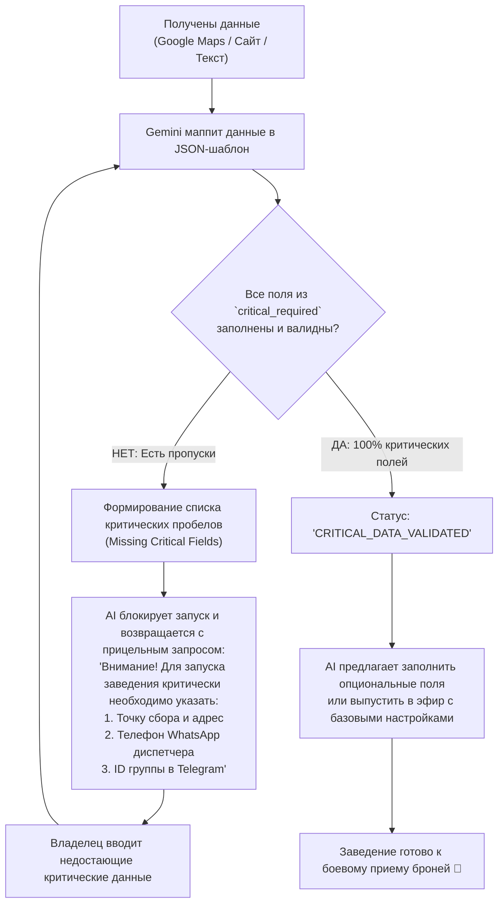

# Revoo Services: Канонический JSON-шаблон онбординга заведения (Source of Truth)

**Документ:** Архитектурный стандарт схемы данных онбординга  
**Директория:** `Bible_SoT/Venue_Onboarding_JSON_Schema_SoT.md`  
**Версия:** 1.0 (Production Standard)  
**Область применения:** Онбординг сервисных заведений (`services`), валидация критических данных, аватары `BATCH_CAPACITY` и `PERSONAL_TIME`.

---

## 1. Концепция: Двухуровневый JSON-шаблон (Mandatory vs Optional)

Для гарантии того, что заведение не запустится в «полусыром» виде (без адреса сбора, телефона диспетчера или валюты), система Revoo использует **двухуровневую JSON-схему онбординга**:

1. **Уровень 1: Критические обязательные поля (`REQUIRED_CRITICAL`):**
   * Без этих полей запуск заведения **строго блокируется**.
   * Если при парсинге Google Maps, сайта или первого интервью ИИ обнаруживает отсутствие хотя бы одного обязательного поля, он **в обязательном порядке инициирует целенаправленный возврат к пользователю** и запрашивает недостающие данные.
2. **Уровень 2: Опциональные расширенные поля (`OPTIONAL_ENRICHMENT`):**
   * Данные, повышающие IQ консьержа и детализацию регламентов (зоны пикапа, меню обеда, марки минивэнов, исключения по гражданствам).
   * Могут быть дополнены в любое время через адаптивное до-интервью, стафф-чат Telegram или прямой Markdown-редактор мастер-документа.

---

## 2. Канонический JSON-шаблон (`venue_onboarding_template.json`)

```json
{
  "$schema": "https://revoo.win/schemas/venue_onboarding_v1.json",
  "version": "1.0",
  "archetype": "batch",

  "critical_required": {
    "venue_name": "Sir Visaranus",
    "category": "Визаран & Бордер-ран",
    "country_code": "TH",
    "city": "Паттайя",
    "currency": "฿",
    "timezone": "Asia/Bangkok",
    "phone_dispatcher": "+66 82 123 4567",
    "telegram_group_id": "-100234567890",
    "primary_pickup_location": {
      "name": "ТЦ Central Festival Pattaya (выход к пляжу)",
      "address": "333/99 Moo 9, Beach Rd, Pattaya City, Chon Buri 20260",
      "meeting_time": "05:30"
    },
    "departure_schedule": [
      {
        "departure_time": "06:00",
        "return_eta": "16:30",
        "destination": "Камбоджа (КПП Ban Laem)",
        "operating_days": [1, 2, 3, 4, 5, 6, 7]
      }
    ],
    "base_pricing": {
      "standard_route_name": "Бордер-ран в Камбоджу (Базовый)",
      "base_price": 2900
    },
    "border_passport_minimum_months": 6
  },

  "optional_enrichment": {
    "website_url": "https://visaran-pattaya.example.com",
    "cover_photo_url": "https://images.unsplash.com/photo-1544620347-c4fd4a3d5957",
    "google_maps_url": "https://maps.app.goo.gl/nBEQXmsHCg42sZBbA",
    "tone_of_voice": "respectful_formal",
    "assistant_name": "Ассистент Sir Visaranus",

    "packages_advanced": [
      {
        "name": "Камбоджа VIP Комфорт",
        "price": 3800,
        "includes": [
          "Индивидуальный забор от кондо в центре",
          "VIP-коридор на КПП без очередей",
          "Ряд 1 за водителем",
          "Горячий обед и напитки"
        ]
      }
    ],

    "pickup_zones": {
      "free_condo_pickup": ["Центральная Паттайя", "Пратамнак", "Северная Паттайя"],
      "surcharge_pickup": [
        { "zone": "Джомтьен", "surcharge_amount": 200 },
        { "zone": "На-Джомтьен", "surcharge_amount": 300 }
      ]
    },

    "overstay_regulations": {
      "allowed": true,
      "max_overstay_days": 7,
      "fine_per_day": 500,
      "policy_text": "Оверстей до 7 дней оплачивается официально на границе (500 бат/день). Свыше 7 дней — отказ."
    },

    "passport_photos_required": {
      "count": 2,
      "dimensions": "3x4 см",
      "background": "белый"
    },

    "cancellation_policy": {
      "free_cancel_hours_before": 12,
      "late_cancel_penalty_percent": 50,
      "no_show_penalty_percent": 100
    },

    "fleet_comfort": {
      "vehicle_model": "Toyota Commuter D4D VIP",
      "seats_total": 13,
      "has_ac": true,
      "has_usb_charging": true,
      "has_wifi": true,
      "free_water_bottles": true,
      "luggage_hand_free_kg": 7
    },

    "custom_rules_markdown": "Любые специфические регламенты заведения свободным текстом..."
  }
}
```

---

## 3. Алгоритм работы ИИ: Проверка валидации и цикл обязательного до-интервью



---

## 4. UI-компоненты реализации в админ-панели

1. **Индикатор валидности JSON-схемы (Validation Checklist Card):**
   * Зеленый бейдж: `Критические данные заведения: 10/10 Заполнено ✅`
   * Красный бейдж: `Не хватает 3 обязательных полей для запуска ⚠️` (с кнопкой *«Заполнить с AI»*).
2. **Вкладка «JSON-Конфигуратор & Экспорт/Импорт»:**
   * Возможность для технических администраторов в 1 клик просмотреть или вставить канонический JSON.
   * Кнопка **«Валидировать JSON»** с подсветкой ошибок подсхемы.
3. **Бесшовная синхронизация:**
   * Данные из блока `critical_required` маппятся в типизированные поля Firestore (`venues/{id}`).
   * Данные из блока `optional_enrichment` автоматически вливаются в Мастер-Документ базы знаний (`masterKnowledgeDoc`).
